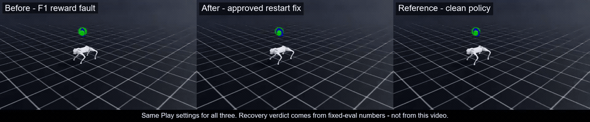
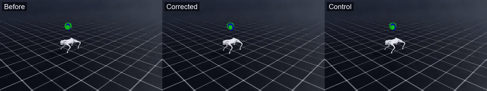
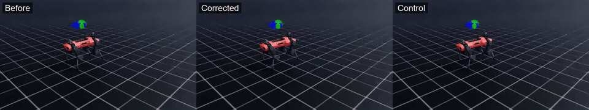

# Isaac Lab RL Training Triage Agent

| Catalog field | Value |
| --- | --- |
| Description | Investigates Isaac Lab RL training failures from telemetry, confirms the cause with short approved probes, applies a registered correction with an approved retraining run, and judges recovery with a fixed behavior evaluation. It can also assess a single run without a healthy reference. |
| Industry | 🤖 Physical AI |
| Requirements | Linux or WSL2 · Docker · OpenShell 0.1.1 · NVIDIA API key (build.nvidia.com) · Isaac Lab 2.1.1 + RTX GPU only for re-running experiments |
| OpenShell | 0.1.1 |
| Collection | Hackathon |

A robot RL run can look fine on its training curves and still fail at the task. In the reward-frame fault below, episodes last almost to the time limit and the training reward rises, but the Go2 ignores velocity commands: its tracking error equals that of standing still. Was it the reward, the actuator, exploration noise, PPO settings, physics or termination?

This agent reads the training telemetry, ranks the likely mechanisms with Nemotron, and asks for one short Isaac Lab probe at a time to confirm or rule them out. Once a mechanism is confirmed, it maps it to a registered code correction and a recovery mode (continue training or retrain), and a fixed 26-command behavior evaluation decides whether the policy recovered. Probes and retraining run only after an approval is recorded, and each approval is consumed once.

New experiment versions use **Nemotron 3.5 Super VL** for diagnosis, correction proposals and video observations. Historical protocols, results and workflow configurations retain their recorded models. A decision that remains invalid after one fixed feedback request ends in HOLD; the new model path does not replace it with a rule decision.

[](docs/media/go2-e2e-e2e_reward_s2030_20261013/comparison.mp4)

*Seed 2030, reward-frame fault: the failed policy stands still, the policy retrained after the registered correction walks, and the healthy policy is shown for reference. Same Play settings for all three. Recovery is judged by the fixed evaluation, not by this video.*

[Presentation replay](https://mmporong.github.io/rl-triage-agent/replay/) · [Interactive architecture diagram](https://mmporong.github.io/rl-triage-agent/?view=single-dark) · [한국어 요약](#한국어-요약)

## What the agent does

1. **Notice.** A tracking alarm and a fixed behavior evaluation show that the policy does not follow commands.
2. **Rank.** Nemotron reads the telemetry and ranks mechanisms such as reward, actuator and exploration.
3. **Probe.** It proposes one short Isaac Lab probe (about 20 seconds). After approval the probe runs, and frozen rules rule mechanisms in or out. The loop repeats until one mechanism remains or it stops.
4. **Correct.** A confirmed mechanism maps to one registered correction and a recovery mode. For reward faults, a scope check can flag error terms that the registered correction does not cover, before any retraining.
5. **Verify.** After approval the run is retrained, and the same fixed evaluation compares it with the paired healthy reference.

The residual-diagnosis extension can open a second diagnostic epoch after a verified non-recovery receipt. It allows at most two distinct registered corrections, with a new confirming probe and approval for each.

Unsupported mechanisms and insufficient evidence end as HOLD without a correction request.

A CPU-verified [resumable PPO diagnosis path](docs/RESUMABLE-DIAGNOSIS.md) preserves completed stages across a recorded API failure. Its model selects the first probe and evidence IDs; registered rules choose later probes and the confirmed correction. Unknown pending requests stop without retransmission. The new-seed GPU confirmation is preregistered separately from the existing results.

The [video evidence input contract](docs/VISION-EVIDENCE-CONTRACT.md) extracts six frames on the CPU and binds them to the source video, policy checkpoint and synchronized playback measurements. Missing measurements stay null. The model view contains images and permitted numeric facts; run identifiers, filenames and evaluation labels remain in local provenance. A new [grounded observation worker](evals/grounded_vision_worker_v1.py) validates the frame IDs and timestamps cited by Nemotron 3.5 and journals requests across restarts; its [development protocol](bench/protocols/grounded_vision_development_v1.json) registers two existing Go2 and G1 video inputs with a shared six-request cap.

A [CPU-verified selection path](docs/VISION-INSPECTION-SELECTION.md) gives all three views the same playback measurements, eligible probes and budgets. Text and combined views also share telemetry; the combined view adds six frames and their citation handles. The caller seals inputs and journals requests, while the host supplies arguments and HOLD produces no execution request. A [registered comparison method](bench/protocols/vision_selection_comparison_v1.json) defines how to assess the added frame evidence; no selection benefit has been measured yet.

The [comparison execution boundary](docs/VISION-SELECTION-EXECUTION.md) builds and verifies 24 inputs from four source readiness records, checks actual Brev probe receipts, and preserves completed model responses. A CPU-tested end-to-end request contract binds selected probes and correction approvals to the same seed and checkpoint. The adapter for GPU correction and follow-up evaluation is in development; fresh-data comparison runs remain pending.

The [Brev data collection path](docs/VISION-BREV-DATA.md) binds video frames to commands, motion and camera timing from the same playback. It keeps a fixed six-training-run ledger, checks completed artifacts before reuse and requires a separate renderer synchronization check before model use. A registered FXAA capture policy binds renderer settings to each capture. CPU checks pass; GPU synchronization and the new data collection remain pending.

The [attested render controller](docs/VISION-BREV-RENDER-V2.md) connects source collection to one renderer check per checkpoint and validates retrieved pairs on CPU before releasing model inputs. Its new Isaac collection and model comparison remain pending.

A [portable environment bundle](docs/VISION-BREV-ENVIRONMENT.md) records pinned package versions, installation recipes and explicit cache-file hashes. It can inspect an existing environment without changing it and skip installation when the checked versions match. A separate preflight connects a 20-update normal training run to the existing renderer check under the same GPU lock and budget; its result does not release model inputs. The capture path checks renderer libraries, timestamp registration, manual-capture settings and asset readiness, and preserves raw timing fields. A CPU supervisor checks the SDK child exit and artifacts before the backend verifies the result and GPU release. Complete GPU synchronization and restoration on a new VM remain pending.

## Key results

| Question | Result | Evidence |
| --- | --- | --- |
| Does adapting probe selection improve the full recovery loop? | In one preregistered paired development case on seed 2171, `model_adaptive`, `registry_next` and `fixed_eligible` recovered after two registered corrections. `model_first_then_rule` stopped at HOLD when its second model selection exhausted the registered infrastructure retries after the first correction did not recover. The policies used 8, 10, 9 and 1 probes, respectively. These are four arms of one case, so the result does not establish an advantage for any selection policy. | [Selection comparison](docs/SELECTION-COMPARISON.md#seed-2171의-비교-결과) · [Result](evals/results/selection_comparison_s2171_20261023/summary.json) |
| Can it diagnose a fault that remains after a correction? | In a preregistered development run with combined reward-frame and PPO epoch faults, seeds 2120 and 2121 both remained unrecovered after one correction and recovered after two. The model selected reward first on one seed and optimizer first on the other. All four diagnosis selections were valid; no registered-rule fallback was used. The run used 8/20 API requests. | [Two diagnostic epochs](docs/RESIDUAL-DIAGNOSIS-RESULT.md#v2-두-번째-검사와-교정-뒤-회복) · [Results](evals/results/residual_success_public_20261017/summary.json) |
| Does the full loop recover a failed run? | Three runs on new seeds recovered under preregistered criteria: a reward-frame fault (seed 2030), a motor torque-speed fault (seed 2033) and a reward-frame fault decided through the NeMo Agent Toolkit tool-calling path (seed 2034). In the motor run the first judgment ranked reward first; three approved probes rejected reward and exploration and confirmed the actuator. A fourth motor-fault run (seed 2046) added a validation-feedback retry to both model decisions and also recovered; both first answers were valid, so no retry was used. | [End-to-end demonstration](docs/E2E-REWARD-DEMO.md) |
| Does the loop carry over to a second robot? | On ANYmal-C flat, a robot with an LSTM actuator network and push and center-of-mass randomization during training, the frozen probes, fixed evaluation contract, registered corrections and model decision path were reused; only the task id, the training and evaluation entry points and the packet's task text changed, and the fixed evaluation turns the two randomization events off. Three healthy runs set the ANYmal-C judgment band, with no false alarm from the probes or the tracking alarm between them. A reward-frame fault on a new seed (2047) was then confirmed with one approved probe, and the retrained policy recovered under the preregistered criteria. | [ANYmal-C port](docs/ANYMAL-C-PORT.md) |
| Can it flag an incomplete correction, and can a wider registration recover the run? | For a reward fault ported from UniLab PR #1254, the scope check flagged an uncovered yaw-tracking term, and the original correction did not recover. After seeing that result, the designers registered a correction restoring all four affected reward functions. The failed source policy on seed 2051 recovered after a corrected restart on seed 3051. A preregistered confirmation on new source seed 2062 also recovered after a corrected restart on seed 3062. The NONE controls stayed healthy in both runs. These development confirmations did not run the model decision loop. | [Scope extension](docs/U1-SCOPE-EXTENSION.md) · [Seed 2051](evals/results/u1_scope_extension_s2051_20261015/summary.json) · [New seed 2062](evals/results/novel_u1_scope_confirmation_s2062_20261016/summary.json) |
| Fix and continue training, or retrain? | After the reward-frame correction, continued training and continued training with reset action noise did not recover on two seeds; retraining from scratch did. | [Recovery-mode comparison](docs/TRAINING-CORRECTION.md#회복-방식-비교-v4) |
| Can a partial reset recover the reward-fault policy? | With 300 updates, resetting the actor's last layer recovered seed 2026 but not 2028; optimizer-state and critic resets recovered neither. A registered follow-up on seeds 2063 and 2064 recovered 2/2 with actor reset versus 0/2 with corrected continuation. In a separate budget check on seeds 2090 and 2091, actor reset recovered 0/2 at each of 100, 150 and 200 updates, while restart at 300 updates recovered 2/2. The 300-update intervention remains a registered conditional candidate; no smaller-budget candidate qualified. The global recovery policy is unchanged, and the mechanism remains unconfirmed. | [Reset comparison](docs/TRAINING-CORRECTION.md#새-seed-출력층-재설정-확인) · [Budget check](docs/TRAINING-CORRECTION.md#출력층-재설정의-단축-예산-확인) · [Budget results](evals/results/actor_reset_budget_public_20261017/summary.json) |
| How many probes does it take? | On 18 hidden-fault runs, all six probes confirm 17. Probes ordered from the agent's top-3 hypotheses confirm 14 with 2.1 probes on average and no wrong confirmation. | [Probe loop](#detailed-results) |
| What happens with faults it was not built for? | The frozen six-probe loop left all three runs of one external-source fault without a supported cause (`none_supported`), with zero wrong confirmations. It also missed R1, a PPO epoch-count fault ported from rsl_rl issue #38. After seeing R1, the designers registered a count inspection and epoch restoration. In a development demonstration on new seed 2071 the extended model loop confirmed the fault, proposed the registered correction, and recovered after retraining on seed 3071; all 13 preregistered completion conditions passed. | [External faults](docs/T1-EXTERNAL-FAULTS.md) · [Original R1 stop](evals/results/upstream_r1_loop_20261014/result.json) · [R1 repair](evals/results/r1_repair_s2071_20261016/summary.json) |
| Can inspection results change the diagnosis? | In the R1 repair run the model ranked reward first and optimizer fourth, then proposed the reward probe. Five normal probe results removed hypotheses before the registered count inspection found 4 optimizer steps per update against the expected 20. The loop confirmed the optimizer update-count subtype. After epoch restoration and retraining, velocity RMSE was 0.148 m/s, against 1.169 for the failed policy and 0.146 for the healthy reference. The model chose the first probe; registered rules chose subsequent probes and updated hypotheses. | [Optimizer inspection and repair](docs/OPTIMIZER-OBSERVABILITY.md#검사에서-교정회복까지-연결한-실행) · [Development inspection set](evals/results/optimizer_observability_gpu_20261015/summary.json) · [Earlier new-seed confirmation](evals/results/novel_optimizer_confirmation_20261016/summary.json) |
| Can it detect a PPO calculation error when update counts remain normal? | In a preregistered development measurement, an injected inverse-ratio fault kept optimizer-step and minibatch counts normal but violated the clipped-surrogate gradient invariant from update 0 across 60 checked batches. Restoring the ratio calculation returned all three inspections to normal. All 8 runs completed and all 7 registered checks passed. Observer v5 stayed within the 1.5 ON/OFF runtime-ratio limit on three seeds. A later end-to-end run trained healthy and faulty source policies for 300 updates, and the fixed evaluation confirmed the behavioral failure. The decision model broke the output contract on its first answer and again after the one registered feedback retry, so the run stopped with `model_invalid` before any probe or correction. The invalid decision was not replaced by a rule. | [PPO gradient check and end-to-end stop](docs/PPO-GRADIENT-CHECK.md#종단-실행-v4의-모델-판단-보류) · [C4 result](evals/results/ppo_ratio_repair_s2165_20261023/summary.json) · [Measurement results](evals/results/ppo_gradient_v5_20261017/result.json) · [Replay](docs/replay/ppo-gradient.html) |
| Does a correction registered on one robot apply to another? | A shared applicability contract checks, in order, that the fault targets exist and are active in the task, that injection changed them, that the fault policy fails the fixed evaluation, that the correction covers every active target, that it leaves the healthy functions unchanged, and that the recovery mode is registered. Replaying earlier records gives `not_applicable` (ANYmal-C F2), `source_failure_absent` (ANYmal-C F6), `scope_insufficient` (U1 before the scope extension) and `ready` (U1 after it, Go2 F1). In a preregistered registered-rule run on ANYmal-C with the four-function U1 reward fault (new seed 2151), the fault policy stayed nearly in place (velocity RMSE 1.201 m/s, against 0.187 for the healthy policy), the contract reached `ready`, and the restart restoring all four functions (seed 3151) passed all four fixed-evaluation checks (0.194 m/s). No model calls were made. The diagnosis loop's base correction runner now goes through the same contract, extended with scope checks for actuator and termination confirmations; on six public loop records it creates three requests (Go2 F1 and two Go2 motor-fault loops, all `ready`) and three HOLDs. | [Applicability contract](docs/COMBINATION-APPLICABILITY.md) · [Result](evals/results/combination_anymal_u1_s2151_20261017/summary.json) |
| Are model decisions repeatable? | 55 repeated calls on 11 inputs: every valid output gave the same decision, but 6 outputs broke the output contract. In a separate run, returning the validation errors and asking once more left 1 of 55 invalid. Forcing a JSON schema made it worse (37 of 55 broke the contract). | [Repeated decisions](docs/N2-PASS-K.md) |
| Can it find the harmful change among several code changes? | Each case mixed one harmful change with seven harmless ones, and confirmation retrains were counted for bisection, one-by-one reverts, a probe-category rule and model rankings. Preregistered verdict: no comparison, because only two cases were valid; in the third, reverting the harmful change alone still left yaw tracking outside the healthy band. In the four model calls on the valid cases the harmful change was ranked first, but one output cited diff line numbers that do not exist and was rejected. | [Multi-change experiment](docs/D3-MULTI-CHANGE.md) |
| What does the new Nemotron add? | The Nemotron 3.5 Super VL endpoint adds observations of policy playback. In the registered development set, 17/18 observations corresponded to fixed-evaluation policy labels. A separate fresh-seed reward-fault demonstration (2080, corrected restart 3080) recovered and recorded three valid observations: healthy walking, failed in place, corrected walking. All three corresponded to the fixed-evaluation labels; this is descriptive correspondence, not video accuracy or a recovery decision. The run used 5/16 API requests. Output-contract, evidence-citation and NAT-argument comparisons did not meet their resolution criteria. That demonstration retained 3 Super for decisions; new experiment versions register 3.5 Super VL separately and keep those results separate. | [Comparison](docs/NEMOTRON-ENDPOINT-COMPARISON-V3.md) · [Integrated observation](evals/results/vl_aux_demo_public_s2080_20261016/summary.json) |
| Is it better than rules? | Not claimed. On the hidden-fault set the agent ranked the true mechanism first in 8 of 18 runs against 2 to 6 for the baselines, a small sample. On the first benchmark, simple rules solved all held-out cases. | [Detailed results](#detailed-results) |

[](docs/media/scope-transfer-u1-s2051-v1/comparison.mp4)

*U1 scope extension: failed policy (seed 2051), four-function correction followed by retraining (seed 3051), and healthy reference (seed 2051). [Video provenance](docs/media/scope-transfer-u1-s2051-v1/source_manifest.json).*

[](docs/media/scope-transfer-anymal-s2047-v1/comparison.mp4)

*ANYmal-C: failed policy (seed 2047), corrected retraining (seed 3047), and healthy reference (seed 2047). All three policies in each comparison use the same Play settings. The videos preserve the linked fixed-evaluation labels and do not supply a new recovery judgment. [Video provenance](docs/media/scope-transfer-anymal-s2047-v1/source_manifest.json).*

The earlier [six-policy recovery-mode video](docs/media/go2-correction-reward_v4_s2026_20261013/comparison.mp4) compares continuation, noise reset and retraining on seed 2026. Its retrained checkpoint is byte-identical to the original healthy checkpoint, so that recovery confirms restoration of the code path. [Result and video replay](docs/replay/additional-checks.html).

**What these results do not show.** Faults, probes and corrections were written by the same team, and each result comes from two flat-terrain locomotion tasks (mostly Go2; two reward-fault demonstrations on ANYmal-C) and a few seeds. They are integration evidence, not evidence of diagnosis accuracy, generalization, an advantage of the model over rules, or GPU savings. Approvals were operator approvals delegated by the user; approver strings are recorded, not authenticated.

## At A Glance

| Question | Answer |
| --- | --- |
| Category | Community Recipe |
| Contributor or provenance | Team Mollet (Korea Agentic AI Hackathon 2026) |
| Use this when | An Isaac Lab RSL-RL training run fails, with or without a known healthy reference |
| You will get | Ranked hypotheses with telemetry evidence and one next measurement or experiment. Reference-based workflows can register an experiment and obtain a verification verdict; single-run assessments are saved under `preregistrations/assessments/<case>.json`. |
| Runs on | Linux or Windows 11 + WSL2 (Ubuntu 24.04) with Docker; Isaac Lab on a Windows or Linux RTX host for retraining |
| Requires | NVIDIA API key for `nvidia/nemotron-3-super-120b-a12b`, OpenShell 0.1.1 gateway, `uv` |
| Verified on | Windows 11 + WSL2 Ubuntu 24.04, Docker 29.8.1, OpenShell 0.1.1, NeMo Agent Toolkit 1.9.0, Isaac Sim 4.5.0 / Isaac Lab 2.1.1, RTX 3060 12 GB |
| Evidence level | live end-to-end |
| Support and maturity | Best-effort community support; hackathon prototype |
| External access, data, and actions | Sends telemetry summaries, selected configuration facts when supplied, and agent messages to `integrate.api.nvidia.com` (NVIDIA API). The optional VL observation stage also sends sampled Play frames. Tools write assessments, preregistrations and analysis scratch files in the workspace. Approved verification writes evaluation records and new runs under the Isaac Lab log directory. |
| Start here | [Quickstart](#quickstart) |
| Confirm success | [Verification](#verification) |

## How it works

[Open the interactive diagram](https://mmporong.github.io/rl-triage-agent/?view=single-dark) · [Archify JSON source](docs/diagrams/rl-triage-unified.architecture.json)

The default sandbox has no bridge submission tool or access; the host submits the approval request. The diagram also shows the offline permission checks by `evals/prove_policies.py`, separately from the agent runtime.

| NVIDIA component | Role here |
|---|---|
| Nemotron 3 Super 120B (build.nvidia.com) | Decision model in historical demonstrations and frozen workflow configurations |
| Nemotron 3.5 Super VL endpoint | Diagnosis and correction proposals in new experiment versions; auxiliary observations of six Play frames per policy remain separate from recovery decisions |
| NeMo Agent Toolkit 1.9 (`nvidia-nat`) | Agent workflows (`configs/*.yml`) and tools (`src/rl_triage/nat_functions.py`, `src/rl_triage/nat_single_run.py`); the tool-calling decision path of the seed 2034 demonstration |
| OpenShell 0.1.1 | Sandbox image, Landlock filesystem policy, L7 REST network policy, NVIDIA provider (the agent only sees a placeholder key) |
| openshell-prover 0.1.1 | SMT check of every requested permission against `policies/site_boundary.yaml` |
| NVIDIA Skills | `skills-lock.json`; own skill `skills/isaaclab-rl-triage` in NVIDIA skill format; the checklist of the Isaac Lab `isaaclab-debugging-rl-training` skill (experimental) validates model correction proposals (`evals/correction_model_call.py`) |
| Isaac Lab 2.1.1 / Isaac Sim 4.5 | Fault injection, probes, retraining, fixed evaluation and recorded clips |

After a diagnosis is confirmed, the base runner [`evals/correct_v2.py`](evals/correct_v2.py) turns the mechanism into at most one correction request, and only when the applicability contract described below returns `ready` for a host-built manifest whose fault checkpoint and scope measurement match the loop's own records. The recorded demonstrations used the earlier runner [`evals/correct.py`](evals/correct.py), which has no contract gate. The [correction registry](src/rl_triage/correction_registry.py) maps the reward, actuator and termination mechanisms to one registered correction each and sets the recovery mode with a preregistered rule. An append-only [correction ledger](src/rl_triage/correction_ledger.py) binds each request to the loop state, correction and recovery mode, refuses duplicate effects, and consumes one recorded approval before a run writes its receipt. The [residual-diagnosis extension](evals/residual_demo_v2.py) uses a separate registry with PPO epoch restoration and permits a second distinct correction only after verifying the first correction's non-recovery receipt. A model correction proposal is validated and attached as evidence; the request always carries the rule-based correction. The rule was visible to the model, so agreement between the two is not independent evidence.

The optimizer inspection layer counts optimizer steps and minibatches. In the registered inverse-ratio development measurement, its [PPO gradient check](docs/PPO-GRADIENT-CHECK.md) also compared the observed clipped-surrogate gradient with the value implied by the saved advantage and policy ratio. It distinguished that injected calculation fault while both count measurements remained normal; other PPO calculation faults need separate measurements. In both the base runner and the combination runner, a [combination applicability contract](docs/COMBINATION-APPLICABILITY.md) checks the robot, fault and correction together before a correction request is created; only the `ready` state creates a request in the correction ledger. The combination runner keeps the first contract version, whose scope check covers reward corrections only. The base runner uses a second version that also covers actuator (`P_torque`) and termination (`P_episode`) confirmations: the confirming measurement must still be abnormal under the frozen threshold against the loop's healthy reference, and the registered correction must restore every target the fault changed.

This recipe follows the **OpenShell path** described in the NemoClaw docs ("you use OpenShell as the platform and supply your own container, policy YAML, provider setup"), because the workload is a custom analysis image rather than a NemoClaw reference harness. NemoClaw's current blueprint pins OpenShell 0.0.116, while the prover features used here are in OpenShell 0.1.x. On this Windows host the NemoClaw onboarding stopped at preflight with `host.platform.wsl_native_docker_unqualified`, so the NemoClaw path needs Docker Desktop. The skill in `skills/isaaclab-rl-triage` is in NVIDIA skill format for `nemohermes <name> skill install`, but that path is not verified here.

## Detailed results

**First benchmark.** 10 injected faults (reward, actuator, exploration, optimizer, physics, termination) on `Isaac-Velocity-Flat-Unitree-Go2-v0`, 1024 envs, 100 iterations. Each case mixes 1 harmful and 2 benign hydra overrides, shuffled with a secret seed.

| Task | Set | RL Triage Agent | Single-prompt Nemotron 3 Super (summary-only input) | Random |
|---|---|---:|---:|---:|
| A. Which change broke it? (change list + telemetry) | dev (seeds 42, 7) | 20/20 | 20/20 | 33% |
| B. Unknown cause: which mechanism? (telemetry only) | dev (seeds 42, 7) | 10/20 | 8/20 | 17% |
| B. Unknown cause | held-out (seed 123) | 6/10 | 2/10 (not significant, n=10) | 17% |
| B. Unknown cause, top-2 | held-out (seed 123) | 6/10 | 6/10 | 33% |
| A. Which change broke it? | held-out (seed 123) | 10/10 | 10/10 | 33% |

Deterministic baselines without a model solved the same held-out set: fixed rules on normalized telemetry, the nearest dev case and a config diff each scored 10/10 top-1 ([`p0a2_holdout_20261008`](evals/results/p0a2_holdout_20261008/)). The held-out seed reuses the same 10 fault templates, so this set tests recognition of known templates, and we withdraw the claim that the agent diagnoses better than a deterministic rule set on it. At 100 iterations even the healthy reference barely follows velocity commands, so later experiments use the Isaac Lab default budget (4096 envs × 300 iterations), where the reference walks (tracking error 0.15 m/s against 1.18 m/s standing still).

**Hidden-fault set.** Six faults that change code or runtime state rather than the saved config (reward frame, DC-motor curve, sampling noise, frozen critic, runtime friction, early time-out), one per mechanism, trained on seeds 2026 to 2028. All 18 fault runs fail the fixed evaluation, and their saved params differ from the reference only by run name ([`replay_p0c_20261009`](evals/results/replay_p0c_20261009/)).

| Method | Input | Top-1 | Top-2 |
|---|---|---:|---:|
| Label frequency / config diff | none / params | 3/18 | 6/18 |
| Frozen rules from the first benchmark | telemetry | 5/18 | 9/18 |
| Nearest case from the first benchmark | telemetry + its labels | 6/18 | 6/18 |
| Single prompt, full time series | same telemetry as the agent | 2/18 | 8/18 |
| RL Triage Agent | telemetry + analysis tools | 8/18 | 12/18 |

Six fault types over three seeds is a small sample and the rules came from a different training budget, so this is not a claim of superiority. The agent's analysis code ran under a Landlock sandbox that cannot read the answer key.

**Probe loop.** Instead of retraining, the loop ([`evals/loop.py`](evals/loop.py), [`p1a_loop_compare_20261009`](evals/results/p1a_loop_compare_20261009/)) proposes one measurement probe at a time: noise, critic learning, reward recomputation, torque saturation, runtime physics and episode length. On the 18 hidden-fault runs, all six probes confirm 17; probes ordered from the agent's top-3 hypotheses confirm 14 with 2.1 probes on average and no wrong confirmation. The probes and the faults were written by the same person, so this shows that the loop works, not that it generalizes.

**External faults and healthy inputs.** With a frozen probe set, three external-source faults ended as `none_supported` with zero wrong confirmations ([protocol and results](docs/T1-EXTERNAL-FAULTS.md)). A no-intervention gate returned `do_not_open_loop` for all three healthy development inputs, with no model calls or probes ([protocol and results](docs/T2-NO-INTERVENTION.md)).

**Security** (`evals/results/policy_proofs.json`, `evals/results/sandbox_kernel_tests.txt`):

| Threat | Control | Evidence |
| --- | --- | --- |
| Agent edits configs, joint limits or rewards to pass the gate | No config path in the sandbox filesystem policy; bridge has no config API (405) | kernel test PASS; prover counterexample `PUT /config/` |
| Checkpoint or robot model exfiltration | Only `POST /v1/chat/completions` on `integrate.api.nvidia.com` | kernel test PASS; prover counterexample `huggingface.co:443` |
| GPU retraining abuse | Preregistration required + human CLI approval; no HTTP approval route | `tests/test_security.py` |
| API key leakage | OpenShell provider injects the key at egress; the sandbox sees `openshell:resolve:...` | observed in sandbox run |
| Writing reference data | Landlock read-only; prover returns `unsupported` → fail-closed reject | kernel test PASS |

## Quickstart

```bash
git clone https://github.com/mmporong/rl-triage-agent.git "$HOME/rl-triage-agent"
cd "$HOME/rl-triage-agent"
uv sync
uv run pytest -q tests                                   # unit + app-level security tests
uv run python bench/build_workspace.py 42                # benchmark telemetry + public reference params -> workspace/seed42
export TRIAGE_WORKSPACE=$PWD/workspace/seed42            # tools read this workspace
export NVIDIA_API_KEY=nvapi-...                          # build.nvidia.com
uv run nat run --config_file configs/triage_workflow.yml \
  --input "Triage failed training case_id=c01. Find the root-cause change and register the next experiment."
```

Inside OpenShell (WSL2/Linux with Docker):

```bash
openshell provider profile import -f policies/providers/nvidia.yaml --global
docker build -f docker/Dockerfile.sandbox -t rl-triage-sandbox:0.1 .
bash scripts/sandbox_up.sh 42                            # provider + workspace image + sandbox with policies/triage_agent.yaml
openshell sandbox exec -n rl-triage --env HOME=/tmp -- bash -c 'cd /sandbox/app && nat run --config_file configs/triage_workflow.yml --input "Triage failed training case_id=c03."'
```

Human-approved retraining (Isaac Lab host):

```bash
uv run python -m rl_triage.eval_bridge serve             # agent side can only submit
uv run python -m rl_triage.eval_bridge list              # human
uv run python -m rl_triage.eval_bridge approve <id>      # human: retrain with one variable changed -> verdict
```

### Assess one run without a healthy reference

Prepare a separate workspace containing:

```text
workspace/single_run/
  reference/telemetry.json
  cases/<case_id>/telemetry.json
  cases/<case_id>/configuration.json  # required when context.json is present
  cases/<case_id>/context.json        # optional source hashes and selected facts
```

Set `reference/telemetry.json` to exactly `{"reference_status":"absent","summary":{},"series":{}}`. The case telemetry must contain `summary` and `series` objects. Each summary metric uses `n`, `first`, `last`, `min`, `max`, `mean_first_20pct` and `mean_last_20pct`; each series maps a metric name to its scalar samples. To provide reward, observation or sensor definitions, follow [the configuration evidence format](docs/SINGLE-RUN-CONTEXT.md).

```bash
cd "$HOME/rl-triage-agent"
export TRIAGE_WORKSPACE="$PWD/workspace/single_run"
export TRIAGE_ANALYSIS_SANDBOX=required
uv run nat run --config_file configs/triage_single_run.yml \
  --input "Assess failed run case_id=<case_id>. Task context: <task and observed failure>."
```

The assessment is saved once to `preregistrations/assessments/<case_id>.json` and marked `hypotheses_only`: one run alone cannot establish normality, recovery or a confirmed cause. This workflow makes model API calls but does not start Isaac or retrain.

## Verification

**Evidence level:** live end-to-end

```bash
uv run python evals/prove_policies.py
OPENSHELL_SANDBOX=1 python -m pytest -q tests/sandbox    # inside the sandbox
uv run python evals/run_eval.py --task blind --seed 123 --mode both --tag heldout
```

**Expected result:**

```text
triage_agent           result=within_boundary   gate=human_review PASS
bad_exfil_checkpoint   result=exceeds_boundary  gate=auto_reject  PASS
bad_patch_config       result=exceeds_boundary  gate=auto_reject  PASS
bad_write_reference    result=unsupported       gate=auto_reject  PASS
ok_request_eval        result=within_boundary   gate=human_review PASS
8 passed                                                  # tests/sandbox
```

**This verifies:** permission proofs, kernel enforcement inside a live OpenShell sandbox, agent scores on recorded Isaac Lab telemetry, and the approve → retrain → verdict loop on a real Isaac Lab run.

**This does not verify:** faults that only appear in long training (>100 iterations), rough terrain, robots other than Go2 and ANYmal-C, manipulation tasks, real robots, or multi-sandbox fleets.

### Offline replay (no API key, network or GPU)

A clean checkout can recompute the stored scores from public files only. The replay and the workspace builder use the Python standard library; they do not import the model client or NeMo Agent Toolkit.

```bash
python evals/replay.py evals/results/blind_v1 evals/results/heldout_blind evals/results/heldout_changes \
  --traces evals/results/traces             # add --tag <new-folder> to save evals/results/<new-folder>/replay.json
python bench/build_workspace.py 123 --blind # public params from bench/reference/; the blind leak check runs automatically
python evals/replay.py evals/results/p0a2_holdout_20261008
```

For each (task, seed, case, mode), the last row with `infra_error: false` counts; every retry in the results files was triggered only by an infrastructure error (overload, empty or truncated response), never by a wrong answer. Truth, top-1 and top-2 are recomputed from the public answer keys, and the replay fails if any stored value differs. `--traces` fails on answer-file or `../..` markers in saved tool calls. Expected:

```text
evals/results/blind_v1: rows=47 infra=7 mismatches=0
  blind    agent         top-1 10/20  top-2 12/20  seeds=7,42
  blind    control       top-1 8/20  top-2 10/20  seeds=7,42
evals/results/heldout_blind: rows=22 infra=2 mismatches=0
  blind    agent         top-1 6/10  top-2 6/10  seeds=123
  blind    control       top-1 2/10  top-2 6/10  seeds=123
evals/results/heldout_changes: rows=22 infra=2 mismatches=0
  changes  agent         top-1 10/10  top-2 10/10  seeds=123
  changes  control       top-1 10/10  top-2 10/10  seeds=123
evals/results/traces: trace files=68 leak hits=0
status=pass
```

The contract-gated correction step can be replayed on six public loop records the same way:

```bash
python evals/correct_v2.py replay
```

It copies the loop records to a temporary folder and stops at the proposal step. The Go2 F1 seed 2080 loop reaches `ready` and one request (`restore_body_frame_reward`, `restart`); the two Go2 motor-fault loops (seeds 2046 and 2033) each reach `ready` and one request (`restore_motor_torque_speed`, `restart`), recorded as chosen by the registered rule because the confirming `P_torque` was the third probe; the U1 seed 2040 loop stops at `scope_insufficient`; an unidentifiable loop and a loop that confirmed an unregistered mechanism end in HOLD before the contract. The output reports `"status": "pass"` when all six match.

The [presentation replay](docs/replay/index.html) reads only committed public results. `python evals/build_replay_page.py` checks each source file against its commit, replays the public correction bundles, binds each comparison video to the hash in its recording manifest and writes `docs/replay/data.js`; `--check` reports whether `data.js` matches the committed results. Correction and recovery experiments publish their own replay commands in the linked documents.

## Development records

Earlier development steps, each with its own protocol, results and limits:

- [Brev compute pilot](docs/BREV-COMPUTE-PILOT.md): the pinned normal Go2 workload completed 300 updates on two paired seeds on both an RTX PRO 6000 96GB instance and an L40S 48GB instance. The records cover instance compatibility, throughput, source and checkpoint hashes, separately from diagnosis and recovery evaluation.
- [Brev registered-F1 run](docs/BREV-RECOVERY.md): the Linux path completed normal and faulted 300-update training and the 26-condition source evaluation. One model-selected `P_episode` probe was normal; the next model decision returned HTTP 500 twice and the loop ended in HOLD after 3/20 API requests. No correction or recovery evaluation was requested.
- [Grounded single-run workflow](docs/GROUNDED-SINGLE-RUN.md): checks structured hypothesis premises against source-bound evidence and registers one read-only next check.
- [Active diagnosis driver](docs/ACTIVE-DIAGNOSIS.md) and [its integration results](docs/ACTIVE-DIAGNOSIS-V2-RESULT.md): a fresh Nemotron probe choice connected to an approval ledger and a fixed Isaac measurement; 0 of 8 model cases met the measurement-dependent judgment-change criterion.
- [Training correction by continued training](docs/TRAINING-CORRECTION.md): three development cases (reward frame, motor curve, timeout) returned `no_recovery` after 300 additional updates; also the policy-free motor-curve inspection.
- [Callback correction feasibility](docs/RECOVERY-FEASIBILITY.md): the fault conditions also passed the behavior checks, so this correction is not used as a recovery demonstration.
- [Live approval-loop records](docs/LIVE-LOOP-EVIDENCE.md): eight cases after twelve approved probes, with acceptance limits.
- [Evidence video](docs/media/evidence-v2-20261011-recovery-q4/evidence.mp4) and its [manifest](docs/media/evidence-v2-20261011-recovery-q4/manifest.json): failure observation, probe selection, measurement and HOLD.

## Limitations

- Benchmark circularity: faults, probes, corrections and the agent were built by the same team. Mitigations: benign changes mixed in with a secret seed, prompts committed before each evaluation, same-model single-prompt baseline, held-out seeds, and a small number of faults ported from external sources.
- Two flat-terrain locomotion tasks: most results use `Isaac-Velocity-Flat-Unitree-Go2-v0`; `Isaac-Velocity-Flat-Anymal-C-v0` has three healthy runs and two reward-fault demonstrations.
- The main loop's registered corrections cover three mechanisms. Other faults end as HOLD or trigger a scope warning. The ported UniLab fault first triggered that warning; a four-function correction registered after seeing the result recovered follow-up source seeds 2051 and 2062 outside the model decision loop.
- Single model calls sometimes break the output contract; a validation-feedback retry reduced this on already seen inputs and is not yet part of the demonstrations.
- The skill's mechanism table (`skills/isaaclab-rl-triage/SKILL.md`) was written after looking at benchmark telemetry; scored runs do not load the skill.
- Network rules apply to child processes, so code run by `run_analysis` can still reach the allowed NVIDIA inference path.

## 한국어 요약

- 영상 입력 준비기는 원본에서 프레임 여섯 장을 추출하고 정책·동기화 운동 기록과 묶습니다. 기록이 없는 수치는 null로 남기며, 모델 입력에서는 실행 ID·파일명·평가 정답을 제외합니다. 새 관찰 실행기는 Nemotron 3.5가 인용한 프레임 ID·시각을 검증하고 요청 원장을 재개합니다. 기존 Go2·G1 영상 두 입력을 개발 확인용으로 고정했으며, API 상한은 합계 6회입니다. 영상의 행동 묘사와 원인 확정·회복 판정은 구분합니다. [입력 계약](docs/VISION-EVIDENCE-CONTRACT.md) · [개발 사전등록](bench/protocols/grounded_vision_development_v1.json)
- 세 입력이 같은 Play 수치·시각·검사 목록·예산을 공유하는 검사 선택 경로를 CPU로 검증했습니다. 텍스트와 결합 입력의 학습 기록도 같고, 결합 입력에는 여섯 프레임과 인용 ID를 더합니다. 호출기는 입력과 요청 원장을 보존하며 모델은 검사·근거 ID만 고릅니다. 인자는 호스트가 만들고 판단 보류·무효는 실행 요청 없이 멈춥니다. 영상 기여의 판정 기준은 [비교 사전등록](bench/protocols/vision_selection_comparison_v1.json)에 고정했으며 아직 효과를 측정하지 않았습니다. [검사 선택 계약](docs/VISION-INSPECTION-SELECTION.md)
- 입력 구성기는 네 source의 readiness에서 비교 입력 24개를 만들고 원본과 재검증합니다. 종단 요청 계약은 학습·녹화·교정 작업 ID를 구분하고, 같은 seed·checkpoint의 검사 영수증과 승인이 일치해야 교정 요청을 허용합니다. 실제 GPU 교정·후속 평가를 잇는 실행 adapter는 구현 중입니다. [실행 경계](docs/VISION-SELECTION-EXECUTION.md)
- [비교 실행 경계](docs/VISION-SELECTION-EXECUTION.md)는 등록 입력을 원본 Play·렌더 확인·GPU 런타임 기록과 대조합니다. 완료 응답을 보존하고 미완료 요청의 재전송을 차단합니다. 새 GPU 자료를 사용하는 비교 실행은 남아 있습니다.
- [Brev 수집 경로](docs/VISION-BREV-DATA.md)는 같은 Play의 영상·명령·운동·카메라 시각을 묶고 완료 산출물을 확인해 재사용합니다. 학습 여섯 건 상한과 교정 승인 경계를 유지하며, 실제 GPU 동기화 검사가 끝나기 전에는 녹화를 모델 사용 가능 상태로 표시하지 않습니다. 이 경로의 새 GPU 수집은 아직 실행하지 않았습니다.
- [렌더 연결 실행기](docs/VISION-BREV-RENDER-V2.md)는 checkpoint별 동기화 확인을 별도 원장으로 관리하고, 회수한 녹화·확인 기록을 CPU에서 검증한 뒤 모델 입력 준비 상태를 기록합니다. 새 Isaac 수집과 모델 비교는 아직 실행하지 않았습니다.
- [환경 bundle](docs/VISION-BREV-ENVIRONMENT.md)은 버전·설치 recipe·명시한 cache 파일 해시를 보관합니다. 기존 환경을 수정 없이 검사하고 주요 버전이 맞으면 재설치를 생략합니다. 별도 사전 점검은 같은 GPU 잠금·예산 안에서 정상 정책 20회 학습과 렌더 검사를 연결하며 모델 입력 준비와 구분합니다. 캡처 경로는 공유 라이브러리·시각 annotator·수동 캡처 설정·자산 준비를 확인하고 반환 시각 원문을 보존합니다. CPU supervisor가 SDK child의 종료와 산출물을 확인한 뒤 backend가 결과와 GPU 해제를 검증합니다. 새 VM 복원과 전체 GPU 동기화 검증은 남아 있습니다.

- 새 PPO 진단 고리는 모델 출력을 검사·근거 ID 선택으로 제한하고, 저장된 API 오류 뒤 완료 단계의 SHA를 확인해 재개합니다. 미완료 요청은 자동 재전송하지 않습니다. 첫 검사는 모델, 이후 검사와 교정은 등록 규칙이 선택합니다. CPU 상태 전이 검증과 실제 새 seed의 GPU 회복 확인을 구분합니다. [구현과 실행](docs/RESUMABLE-DIAGNOSIS.md)

Isaac Lab 로봇 강화학습이 실패했을 때 원인을 찾아 고치는 에이전트입니다. 학습 기록을 읽어 원인 후보를 고르고(Nemotron), 20초 정도 걸리는 검사로 원인을 확인한 뒤, 미리 등록한 수정과 재학습을 승인받아 실행합니다. 회복 여부는 26개 속도 명령으로 정책을 돌리는 고정 평가로 판정합니다.

- 보상 좌표계와 PPO epoch 결함을 함께 넣은 seed 2171에서 검사 선택 정책 네 가지를 같은 원본에 적용했습니다. `model_adaptive`, `registry_next`, `fixed_eligible`은 첫 교정 뒤 남은 실패를 다시 진단해 두 번째 교정에서 회복했습니다. `model_first_then_rule`은 첫 교정 뒤에도 회복되지 않았고, 다음 모델 요청의 인프라 재시도가 끝나 `HOLD`로 멈췄습니다. production 최종 판단은 10건 중 9건이 유효했고 모델 출력 계약 오류로 멈춘 정책은 없었습니다. 한 paired 개발 사례의 네 arm이므로 정책 우위나 일반화로 해석하지 않습니다. [근거](docs/SELECTION-COMPARISON.md#seed-2171의-비교-결과)
- 보상 좌표계와 PPO epoch 결함이 겹친 새 seed 두 건에서, 첫 교정 뒤 남은 실패를 다시 진단해 두 교정 뒤 모두 회복했습니다. 한 seed는 보상부터, 다른 seed는 optimizer부터 고쳤습니다. 네 검사 선택은 모두 모델 응답이 유효해 등록 규칙 전환 없이 실행됐으며, API는 상한 20회 중 8회를 썼습니다. 앞선 실패 결과를 본 뒤 설계한 개발 측정입니다. [근거](docs/RESIDUAL-DIAGNOSIS-RESULT.md#v2-두-번째-검사와-교정-뒤-회복)

- Go2의 보상·모터 결함에서 학습부터 수정·재학습까지 이어 본 네 번의 실행이 모두 회복했습니다. 모터 결함에서는 첫 판단이 보상을 의심했지만 검사 세 번으로 바로잡았습니다.
- 다른 로봇(ANYmal-C 평지 보행)에서도 같은 검사·평가·교정 코드를 그대로 썼습니다. 정상 학습 세 번으로 판정 기준을 정했고, 새 seed의 보상 결함 한 건을 검사 한 번으로 확정한 뒤 재학습으로 회복했습니다.
- 다른 프레임워크에서 옮겨 온 U1 보상 버그에서는 등록 교정의 범위 부족이 표시됐고, 해당 교정 뒤 재학습도 회복하지 못했습니다. 설계자가 이 결과를 본 뒤 보상 함수 네 항을 복원하도록 교정을 넓혔고, source seed 2051에서 재학습(seed 3051)으로 회복했습니다. 사전등록한 새 source seed 2062에서도 재학습(seed 3062)이 고정 평가를 통과했습니다. 두 실행의 NONE 대조는 정상을 유지했으며 모델 판단 고리는 사용하지 않았습니다. [근거](docs/U1-SCOPE-EXTENSION.md) · [2051 비교 영상](docs/media/scope-transfer-u1-s2051-v1/comparison.mp4)
- 보상 버그 교정 뒤 회복 방식을 비교한 v4에서는 이어 학습·탐색 잡음 재설정이 두 seed에서 회복하지 못했고, 처음부터 다시 학습하면 회복했습니다. [사실] actor 마지막 층 재설정은 기존 seed 2026에서 회복하고 2028에서는 미회복이었습니다. 새 seed 2063·2064에서는 300회 재설정이 2/2 회복, 이어 학습은 0/2여서 **등록 조건부 후보**가 됐습니다. 이후 별도 seed 2090·2091의 단축 예산 확인에서는 재설정 100·150·200회가 각각 0/2, 재학습 300회는 2/2 회복했습니다. 단축 예산 후보를 등록하지 않고 기존 회복 규칙을 유지합니다. 이번 seed의 재설정 300회는 측정하지 않았습니다. [추론] 실패 메커니즘은 아직 미확정입니다. [근거](docs/TRAINING-CORRECTION.md#출력층-재설정의-단축-예산-확인)
- 동결 검사 여섯 종이 놓친 외부 PPO 결함 R1을 본 뒤, 갱신 횟수 검사와 epoch 복원 교정을 등록했습니다. 새 seed 2071에서 모델은 처음 보상을 의심했지만, 다섯 normal 관측 뒤 새 검사가 update당 20회 대신 4회를 찾아 optimizer 결함을 확정했습니다. epoch 복원 후 재학습(seed 3071)이 고정 평가를 통과해 종단 회복을 확인했습니다. 첫 검사는 모델이 선택했고, 이후 검사 선택과 가설 제거는 등록 규칙이 수행했습니다. [근거](docs/OPTIMIZER-OBSERVABILITY.md#검사에서-교정회복까지-연결한-실행)
- PPO 갱신 횟수는 정상이지만 ratio 계산이 뒤집힌 개발 오류에서는, 횟수 검사 두 개가 모두 normal인 동안 gradient 불변식이 update 0부터 오류를 잡았습니다. ratio 계산을 복원하자 세 검사가 normal로 돌아왔습니다. 후속 종단 실행에서 정상 정책과 오류 정책을 각각 300회 학습했고, 고정 평가의 선속도 RMSE는 0.148 m/s와 1.232 m/s였습니다. 진단 응답은 `D_EXPECTED`, 피드백 뒤 `D_RANKING`으로 두 번 무효였고 등록 규칙으로 바꾸지 않아 판단 보류(HOLD) 경계를 유지했습니다. API는 상한 4회 중 2회를 썼으며 검사·교정 요청은 0건입니다. 종단 결과는 `model_invalid`이고 회복 판정은 열지 않았습니다. [근거](docs/PPO-GRADIENT-CHECK.md#종단-실행-v4의-모델-판단-보류)
- Go2에서 만든 U1 네 항 보상 교정을 두 번째 로봇 ANYmal-C에 옮겼습니다. 적용성·주입·행동 실패·교정 범위·정상 무변경·회복 방식을 차례로 확인하는 공통 계약이 `ready`일 때만 교정을 요청합니다. 새 seed 2151에서 U1 정책은 거의 제자리였고(선속도 오차 1.201, 정상 0.187), 계약이 `ready`가 되어 네 항을 복원한 재학습(seed 3151)이 고정 평가를 통과했습니다(0.194). 모델 호출은 없었습니다. 진단 고리의 기본 교정 경로도 모터·종료 범위 검사를 더한 같은 계약을 거치며, 공개 고리 기록 여섯 건을 재생하면 요청 3건(Go2 F1, Go2 모터 결함 두 건)과 HOLD 3건이 나옵니다. [근거](docs/COMBINATION-APPLICABILITY.md)
- 숨은 결함 18건에서 에이전트가 고른 순서로 평균 2.1번 검사해 14건을 확정했고, 틀린 확정은 없었습니다.
- 코드 변경 8개 중 원인 하나를 찾는 실험은 유효 사례가 둘뿐이라 사전등록대로 방법 비교를 판정하지 않았습니다. 유효 사례의 모델 호출 네 번 모두 실제 원인을 1위로 냈지만, 한 번은 없는 코드 줄을 근거로 적어 무효 처리됐습니다.
- Nemotron 3.5 Super VL의 영상 보조 관찰을 연결한 보상 결함 seed 2080 시연은 교정 재학습(seed 3080)으로 회복했고, 정상·결함·교정 정책을 각각 걷기·제자리·걷기로 관찰했습니다. 세 응답이 모두 유효했으며 고정 평가 라벨과 3/3 대응했습니다. 이 시연의 결정 모델은 3 Super였고 영상 관찰은 판정에 쓰지 않았습니다. 새 실행 판에서는 진단·교정 제안도 3.5 Super VL로 등록하며, 이전 결과와 합산하지 않습니다. [근거](docs/NEMOTRON-ENDPOINT-COMPARISON-V3.md#회복-시연에-연결한-영상-보조-관찰)
- 같은 입력으로 모델을 55번 호출하면 유효한 출력의 판단은 늘 같았지만 6번은 출력 형식을 어겼습니다. 틀린 곳을 알려 주고 한 번 더 물으면 1번으로 줄었습니다.
- Brev의 RTX PRO 6000 96GB와 L40S 48GB에서 기존 Isaac 버전·Go2 정상 학습 조건을 유지한 채 두 seed를 각각 300회 학습했습니다. 네 실행이 모두 완료됐고, 학습 시간 중앙값은 각각 136.7초와 184.9초였습니다. 이 파일럿의 범위는 정상 학습의 호환성과 인스턴스 처리량입니다. [근거](docs/BREV-COMPUTE-PILOT.md)
- Brev L40S의 등록 F1 실행은 정상·결함 정책을 각각 300회 학습한 뒤 고정 평가를 마쳤습니다. 선속도 추종 오차는 정상 0.140 m/s, 결함 1.179 m/s였습니다. 모델이 선택한 `P_episode` 검사는 normal이었고, 다음 모델 판단에서 HTTP 500이 두 번 반환돼 API 3/20회에서 HOLD로 멈췄습니다. 교정과 회복 평가는 요청하지 않았습니다. [근거](docs/BREV-RECOVERY.md)

결함·검사·수정을 같은 팀이 만들었고 평지 보행 로봇 작업 둘(대부분 Go2, ANYmal-C는 보상 결함 시연 두 건)과 적은 seed로 얻은 결과라, 진단 정확도·일반화·규칙 대비 우위·비용 절감은 주장하지 않습니다. 자세한 수치와 근거 파일은 위 영어 본문과 연결 문서에 있습니다.
