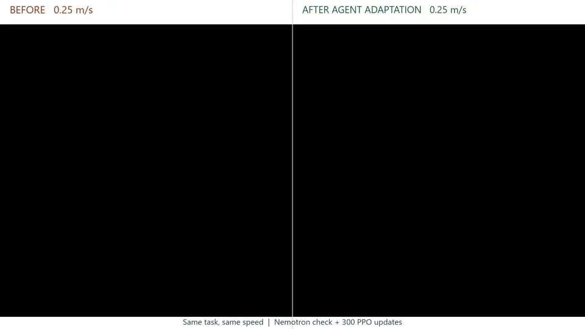

# RL Triage Agent

**Investigate failed robot policies, select corrections or validate proposed code patches, and verify recovery in Isaac Lab.**

[Watch the replay](https://mmporong.github.io/rl-triage-agent/replay/) · [Architecture](https://mmporong.github.io/rl-triage-agent/?view=single-dark) · [Quickstart](#quickstart) · [한국어 요약](#한국어-요약)

| Catalog field | Value |
| --- | --- |
| Description | Evidence-based investigation of Isaac Lab RL failures, with approved checks and fixed evaluation. |
| Industry | Physical AI |
| Requirements | Python + `uv`; NVIDIA API for model calls; an RTX host with Isaac Lab for simulation. Docker + OpenShell for the sandbox path. |
| OpenShell | 0.1.1 |
| Collection | Hackathon · Mollet |

## When the first correction is not enough

In Go2 development seed 2311, Nemotron 3.5 selected checks for a combined reward-frame and PPO-epoch fault. The reward correction left a tracking failure. A second diagnosis selected an optimizer-update check, which measured **4 steps against an expected 20**. The host applied the registered epoch restoration and verified recovery.

| Policy stage | Tracking RMSE, m/s | Fixed26 outcome |
| --- | ---: | --- |
| Compound fault | 1.219 | Not recovered |
| Reward-frame correction | 1.163 | Follow-up diagnosis required |
| Reward + PPO-epoch corrections | **0.142** | **Recovered** |

Nemotron chose all four checks across the two diagnosis rounds. The host applied registered corrections, retrained and evaluated; the corrected training recorded 20 optimizer steps per update. [Checks, corrections and evaluation](docs/NEW-LINEAGE-COMPARISON.md#갱신-계측을-연결한-새-복합-사례) · [Original result](evals/results/runtime_observation_compound_s2311_20261031_v1/summary.json).

## Policy adaptation on stairs

This separate case shows Go2 before and after a registered 300-update adaptation proposed by Nemotron 3.5. The updated policy passes the same stair task at the same commanded speed.

<a href="docs/media/go2-stairs-agent-adaptation-s200-20261106-v3/comparison-15s-1080p.mp4"></a>

*Left: original policy. Right: adapted policy. Both use 0.25m/s on the same stairs. A 15-second excerpt from the 30-second tests on development seed 200. [1080p video](docs/media/go2-stairs-agent-adaptation-s200-20261106-v3/comparison-15s-1080p.mp4) · [1440p originals and evidence](docs/GO2-STAIRS-AGENT-ADAPTATION.md).*

Other recordings: [compound-fault repair](docs/media/five_type_recovery_s5557_20261102_v1/comparison.mp4) · H1 pretrained playback [up](docs/media/stairs_h1_s172_20261030_v1/biped-stairs-up/video/rl-video-step-0.mp4) / [down](docs/media/stairs_h1_s172_20261030_v1/biped-stairs-down/video/rl-video-step-0.mp4). H1 clips are playback references, not agent-repair results.

## How it works

1. **Observe:** read bound training records, task context and available frames.
2. **Select:** Nemotron chooses a registered check and cites evidence IDs.
3. **Check:** the host validates approval, executes the check and returns a receipt.
4. **Correct or adapt:** a confirmed cause permits a registered correction. The generated-PPO development path validates model-written adapter code before training. A separate task contract can permit policy adaptation.
5. **Evaluate:** the host trains, then applies the same fixed evaluation to the resulting policy.

The model selects actions; the host supplies execution arguments and checks authority. Each approval is consumed once. Unsupported causes or persistently invalid model answers end at **HOLD** in the current 3.5 fault-repair path. Other registered versions can record a rule fallback. A second diagnosis round can investigate a failure that remains after correction.

| Component | Role |
| --- | --- |
| Nemotron 3.5 Super VL | Current diagnosis, check selection, adaptation and restricted PPO patch proposals, plus auxiliary frame observations. Frozen experiments retain Nemotron 3 Super. |
| NeMo Agent Toolkit 1.9 | Configured tool workflows and the assessment entry; some experiments use separate host controllers. |
| OpenShell 0.1.1 + prover | File and network restrictions, key injection and permission proofs in the sandbox path. |
| Isaac Lab 2.1.1 / Isaac Sim 4.5 | Simulation, probes, training, fixed evaluation and recording. |
| NVIDIA Skills | Isaac Lab investigation and correction checklists; see `skills/isaaclab-rl-triage`. |

## Recorded results

| Test | Observed result | Evidence |
| --- | --- | --- |
| Generated PPO code patch | Nemotron 3.5 wrote a restricted settings adapter. Development seed 5750: actual updates restored from 4 to 20 per iteration; tracking RMSE **1.173→0.146m/s**, with the healthy control preserved. | [Patch, checks and recovery](docs/GENERATED-PPO-PATCH.md) |
| Follow-up diagnosis and repair | The 3.5 seed 2311 case above recovered after a second diagnosis round and registered correction. Earlier compound-fault seeds 2120/2121 also recovered after two corrections. | [3.5 case](docs/NEW-LINEAGE-COMPARISON.md#갱신-계측을-연결한-새-복합-사례) · [Residual diagnosis](docs/RESIDUAL-DIAGNOSIS-RESULT.md) |
| Same-command stair adaptation | Development seed 200: inverted samples **888→0**, tracking RMSE **0.233→0.064m/s**; the 30-second task changes from fail to pass. | [Stair adaptation](docs/GO2-STAIRS-AGENT-ADAPTATION.md) |
| Registered reward and motor faults | Four new-seed runs recovered. In the motor case, three checks overturned the initial reward hypothesis and confirmed the actuator. | [End-to-end repair](docs/E2E-REWARD-DEMO.md) |
| Robot and correction-scope transfer | ANYmal-C seed 2047 recovered. An expanded U1 correction recovered seeds 2051/2062, evaluated separately from model-selected runs. | [ANYmal-C](docs/ANYMAL-C-PORT.md) · [U1](docs/U1-SCOPE-EXTENSION.md) |

Results are reported per registered task and run. The linked evidence includes protocols, model responses, training receipts and fixed evaluations. See also the [model comparisons](docs/NEMOTRON35-VALUE-COMPARISON.md), [VL checks](docs/VISUAL-INTEGRITY-OBSERVER.md) and [healthy-input tests](docs/T2-NO-INTERVENTION.md).

## Quickstart

Start with a recorded-data replay. It uses no model API or GPU and recomputes stored results rather than running a new investigation.

```bash
git clone https://github.com/mmporong/rl-triage-agent.git "$HOME/rl-triage-agent"
cd "$HOME/rl-triage-agent"
uv sync
uv run python evals/replay.py evals/results/blind_v1 evals/results/heldout_blind \
  evals/results/heldout_changes --traces evals/results/traces
```

For an existing training run, prepare a Nemotron 3.5 evidence packet on CPU:

```bash
export RUN_DIR="$HOME/isaaclab/logs/rsl_rl/<run>"
uv run python bench/extract_tb.py "$RUN_DIR" "$RUN_DIR/telemetry.json"
cat > /tmp/triage-task.json <<'JSON'
{"schema":"nemotron35_task_context_v1","task":"Isaac-Velocity-Rough-Go2-v0","observed_problem":"The trained policy does not follow velocity commands."}
JSON
uv run python -m rl_triage.nemotron35_entry_v1 \
  --run-dir "$RUN_DIR" --task-context /tmp/triage-task.json \
  --out "$PWD/workspace/nemotron35-prepare" --prepare-only
```

Preparation makes no model call and authorizes no probe or training. Output directories are write-once. Registered investigation, approval, execution and status commands are documented in the [CLI guide](docs/REGISTERED-DIAGNOSTIC-RUNTIME.md).

<details>
<summary>Request a model assessment</summary>

Load your NVIDIA key from the existing local secret store, then use a new output directory:

```bash
. "$HOME/.config/nvidia/env"
uv run python -m rl_triage.nemotron35_entry_v1 \
  --run-dir "$RUN_DIR" --task-context /tmp/triage-task.json \
  --out "$PWD/workspace/nemotron35-execute" --execute
```

This requests hypotheses and a next-check proposal. Probe execution, correction, training and recovery evaluation require separate recorded steps.

</details>

## Execution and verification

Verified environment: Windows 11 + WSL2 Ubuntu 24.04, RTX 3060 12GB, Isaac Lab 2.1.1 / Sim 4.5.0. This is a hackathon prototype maintained by Mollet.

Host model calls send telemetry summaries, supplied configuration facts and optional sampled frames to NVIDIA's API. OpenShell provides file/network restrictions and key injection for the sandbox path; host controllers check their own approval records and receipts. See [policy files](policies/) and [sandbox setup](docs/GROUNDED-SINGLE-RUN.md).

```bash
uv run python evals/prove_policies.py
uv run python evals/correct_v2.py replay
uv run python evals/build_replay_page.py --check
```

These check permission proofs, stored correction records and public replay data. They do not launch new training. Live sandbox kernel checks require the sandbox environment; see [pipeline preflight](docs/PIPELINE-PREFLIGHT.md) and [workflow setup](docs/AGENTIC-INVESTIGATION.md).

## Evidence and implementation

| Topic | Read more |
| --- | --- |
| Diagnosis and checks | [Evidence-guided selection](docs/EVIDENCE-GUIDED-DIAGNOSIS.md) · [Optimizer checks and R1 repair](docs/OPTIMIZER-OBSERVABILITY.md) · [PPO calculation check](docs/PPO-GRADIENT-CHECK.md) |
| Corrections and applicability | [Recovery modes](docs/TRAINING-CORRECTION.md) · [Combination contracts](docs/COMBINATION-APPLICABILITY.md) · [External faults](docs/T1-EXTERNAL-FAULTS.md) |
| Model and resource comparisons | [3.5 measurements](docs/NEMOTRON35-EVIDENCE-REPORT.md) · [Reasoning modes](docs/NEMOTRON-REASONING-MODES.md) · [Agent/resource study](docs/MECHANISM-AGENT-RESOURCE-COMPARISON.md) |
| Video and reproducibility | [Video contract](docs/VISION-EVIDENCE-CONTRACT.md) · [Evidence story](docs/AGENTIC-STORY-REPLAY.md) · [Troubleshooting](docs/TROUBLESHOOTING.md) |

## 한국어 요약

RL Triage는 Isaac Lab 로봇 정책이 과제에 실패했을 때, 학습 기록과 관측에서 검사 후보를 고르는 에이전트입니다. Nemotron이 검사를 선택하면 호스트가 승인과 근거를 확인해 실행합니다. 원인이 확인되면 등록 교정을, 별도 과제 계약이 있으면 정책 적응을 실행하고 같은 기준으로 다시 평가합니다. 근거가 부족하면 HOLD로 멈춥니다.

대표 수리 사례는 Nemotron 3.5를 사용한 seed 2311입니다. 보상 교정 뒤에도 추종 실패가 남자 두 번째 진단에서 갱신 횟수 검사를 선택했습니다. 검사에서 기대 20회·실제 4회를 확인했고, 등록된 PPO epoch 복원 후 고정 평가를 통과했습니다. 추종 오차는 1.219→1.163→0.142m/s였습니다. 별도 개발 seed 5750에서는 모델이 제한된 PPO 설정 패치를 작성했고, 실제 갱신 횟수 복원과 함께 추종 오차가 1.173→0.146m/s로 개선돼 고정 평가를 통과했습니다.

계단 영상은 별도의 정책 적응 사례입니다. 같은 0.25m/s 명령을 유지한 개발 seed 200에서 뒤집힘 표본은 888→0으로 줄었습니다. 모델의 검사 선택, 호스트의 등록 교정 실행, 학습과 평가 기록을 사례별로 연결해 공개합니다.
