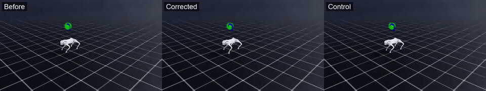

# Isaac Lab RL Training Triage Agent

| Catalog field | Value |
| --- | --- |
| Description | Investigates Isaac Lab RL training failures from telemetry, proposes one next measurement or experiment, and supports human-approved verification inside an OpenShell sandbox. It can compare against a healthy reference or assess a single run without one. |
| Industry | 🤖 Physical AI |
| Requirements | Linux or WSL2 · Docker · OpenShell 0.1.1 · NVIDIA API key (build.nvidia.com) · Isaac Lab 2.1.1 + RTX GPU only for re-running experiments |
| OpenShell | 0.1.1 |
| Collection | Hackathon |

A robot RL engineer changes several settings, trains, and the run collapses. In our own Go2 training ([isaac-walk-rl](https://github.com/mmporong/isaac-walk-rl)), three command-shrinking interventions were rejected in a row (rev28 to rev30), while the same joint-limit symptom had already been recorded 12 days earlier (rev11 Gate01, commit `973769a`, 2026-08-28; attributed in rev31, commit `55159ac`, 2026-09-09). Was it the reward, the actuator scale, exploration noise, PPO settings, physics or termination? This agent reads the training telemetry against a healthy reference run, tests hypotheses with its own analysis code, and hands back **one preregistered experiment** instead of a patched config. A human approves it, the eval bridge retrains in Isaac Lab with only that variable changed, and the result confirms or rejects the diagnosis.

When a healthy reference is unavailable, `configs/triage_single_run.yml` reads one failed run and saves competing hypotheses, measured evidence, limitations and one next measurement. Optional configuration facts are bound to that telemetry by file hashes, and cited configuration values are checked before saving. Its output is marked `hypotheses_only`; it cannot establish normality, recovery or a confirmed cause from that run alone.

The optional [grounded single-run workflow](docs/GROUNDED-SINGLE-RUN.md) checks structured hypothesis premises against source-bound evidence and registers one read-only next check. It loads a neutral group index, selected ID pages and at most 16 detailed evidence records; a host-issued selection receipt restricts the final premises to those IDs. Unvisited evidence remains explicit. Missing, null and zero remain distinct; explanations and physical predictions remain unverified. The [stock-Go2 SDK smoke](evals/results/runtime_readback_sdk_v1_20261011/result.json) verified 20 control steps, 80 observed environment samples and all 7 registered measurements, including source bindings and owned-process cleanup. A separate [base-COM reset calibration](evals/results/base_com_reset_sdk_v3_20261012/result.json) verified 640 finite reset samples per arm: 0/64 reference environments and 64/64 fault environments exceeded the fixed range threshold. This establishes a difference in reset readback.

A separate grounded-active development profile connects a fresh NAT check choice to host approval, one fixed reset measurement and two fresh judgments that receive identical packets with measurement values present or masked. Rule and fixed-ranking controls share the same initial hypotheses and receipt. The registry takes empty tool arguments and identifies the stock-Go2 reset check as the only check connected to this executor. Assessment tools expose the nested validator schema and stop on rejection; inspection receipts do not make missing or null values admissible hypothesis premises. Explicit NAT callbacks record raw call events; missing telemetry remains unknown. Worker failures record the stage and code location without copying exception messages. CPU tests cover input lineage, approval consumption, cleanup and comparison integrity; fresh model integration and policy recovery remain unverified. The reset replay uses its own seed and never counts as a replay of the original training run.

A [registered recovery runner](evals/run_grounded_recovery.py) adds a conditional behavior check after a valid fresh decision and source-bound reset violation. It evaluates the same frozen T1 checkpoint under the fault callback, an unchanged sham callback and the registered correction, using the original fixed evaluation. Recovery requires the corrected arm to walk, both fault arms to fail the same behavior criteria and the sham to match in both comparison directions. Each effect needs a separate consumed approval record. This path has CPU verification coverage; fresh model entry and behavior recovery remain unverified.

A separate model-free [callback feasibility experiment](docs/RECOVERY-FEASIBILITY.md) completed all three conditions with verified execution records. Linear tracking error fell by 0.8439%, but the fault conditions also passed the registered behavioral checks: `no_failure_observed`. This immediate correction is therefore excluded as a recovery demonstration. Its three public reports and verdict can be recomputed with `python evals/replay_recovery_feasibility.py`; the existing agent result remains 0/8.

The [training correction experiment](docs/TRAINING-CORRECTION.md) tests whether a registered code correction can recover an already failed policy through continued training. It binds the original checkpoint, optimizer state and configuration, then compares one selected correction with an unrelated correction that leaves the fault active. A healthy policy receives the same additional training budget. Three development cases have completed all three arms after 300 additional updates. Corrected/control linear tracking errors were 1.161/1.200 m/s for the [reward-frame case](evals/results/reward_resume_dev3_20261013/result.json), 0.188/0.826 m/s for the [motor-curve case](evals/results/motor_resume_dev_20261013/result.json), and 0.176/0.204 m/s for the [timeout case](evals/results/timeout_resume_dev_20261013/result.json). The healthy reference was 0.132 m/s in each case. All three returned `no_recovery` because the corrected policies remained outside the registered healthy range. Each public result folder supports numeric replay. For the motor case, run `python evals/publish_training_correction.py replay evals/results/motor_resume_dev_20261013`; substitute the reward or timeout tag to replay that case. The export also records initial-state hashes and process durations. These are operator-selected development cases; AI selection and generalization remain unverified.

A follow-up [recovery-mode comparison](docs/TRAINING-CORRECTION.md#회복-방식-비교-v4) asks which recovery path returns the reward-frame fault to the healthy range within the same 300-update budget after the registered correction: continued training, continued training with the action-noise standard deviation reset to its configured initial value, or retraining from scratch. It uses the already seen seeds 2026 and 2028 from the hidden-fault set and binds the original checkpoints, configurations and fixed evaluations in [protocol v4](bench/protocols/training_correction_v4.json). Continued-training arms are compared with a healthy policy that received the same additional training; retraining is compared with the original healthy run. Linear tracking errors for continued training / noise reset / retraining were 1.156/1.115/0.148 m/s on [seed 2026](evals/results/reward_v4_s2026_20261013/result.json) (healthy continued reference 0.143 m/s) and 1.137/1.155/0.141 m/s on [seed 2028](evals/results/reward_v4_s2028_20261013/result.json) (0.133 m/s). Both continued-training arms returned `not_recovered` and retraining returned `recovered`, as preregistered for the two predicted arms. On both seeds the retrained checkpoint was byte-identical to the original healthy checkpoint: the corrected code reproduces healthy training with the same seed, so this recovery is an expected confirmation rather than a new effect. A recovery-mode rule recorded before execution (reward mechanism with a standstill ratio of at least 0.9 leads to retraining) matched both seeds; it was derived from one earlier seed and is never used for labels. Each seed folder supports numeric replay with `python evals/publish_training_correction_v4.py replay evals/results/<tag>`, and comparison videos for [seed 2026](docs/media/go2-correction-reward_v4_s2026_20261013/comparison.mp4) and [seed 2028](docs/media/go2-correction-reward_v4_s2028_20261013/comparison.mp4) play all six policies under the same Play settings. These are single development runs per seed on seen inputs; they do not establish generalization or a general rule for reward faults, and the videos are not used for verdicts.

After a diagnosis is confirmed, [`evals/correct.py`](evals/correct.py) turns the confirmed mechanism into at most one correction request. The [correction registry](src/rl_triage/correction_registry.py) maps the reward, actuator and termination mechanisms to one registered code correction each and sets the recovery mode with the preregistered rule; unregistered mechanisms and unsupported diagnoses are recorded as HOLD without a request. An append-only [correction ledger](src/rl_triage/correction_ledger.py) binds each request to the loop state, correction, recovery mode and registry digest, refuses duplicate effects, and consumes one recorded approval before a run writes its receipt. An optional model proposal ([`evals/correction_model_call.py`](evals/correction_model_call.py)) receives only post-diagnosis facts and must return a correction, a recovery mode, cited facts and answers to a checklist derived from the Isaac Lab `isaaclab-debugging-rl-training` skill (experimental); the validator records every rejection reason. The request always carries the rule-based correction and recovery mode, and a validated model proposal is attached only as evidence. In the end-to-end demonstration below the proposal passed validation and matched the rule, but the rule was visible to the model, so the match is not independent evidence.

An [end-to-end demonstration](docs/E2E-REWARD-DEMO.md) connects one new seed at a time from training to an approved correction: post-hoc tracking alarm, fixed evaluation, a fresh Nemotron judgment, approved probes, confirmation, a validated correction proposal, approved retraining with a different seed, and a fixed evaluation of the retrained policy against the same-seed healthy policy. Three runs recovered under their preregistered criteria:

- Reward-frame fault, seed 2030: retraining seed 3030, standstill ratio 0.125; all 11 success conditions and all 6 predictions held.
- [Motor torque-speed fault](docs/E2E-REWARD-DEMO.md#모터-결함-종단-시연-f2), seed 2033: the first judgment ranked reward first; three approved probes rejected reward and exploration and then confirmed the actuator, and two preregistered probes checked that the confirmation was specific. Retraining seed 3033, standstill ratio 0.124; all 12 success conditions and all 7 predictions held.
- Reward-frame fault, seed 2034, with both model decisions made through the [NeMo Agent Toolkit tool-calling path](docs/E2E-REWARD-DEMO.md#nat-결정-경로-보상-결함-종단-시연-seed-2034): retraining seed 3034, standstill ratio 0.124; all 12 success conditions and all 7 predictions held. The tool-calling path was used only after its fourth repeated-call measurement met the preregistered adoption rule; the three earlier measurements were not adopted, and [each round](docs/E2E-REWARD-DEMO.md#nat-경로-비교-e4b) records the observed failure separately from its inferred cause.

Two runs are kept as recorded failures. The [seed 2029 attempt](docs/E2E-REWARD-DEMO.md#시연-v1-결과-seed-2029) ended as `correction_unknown` after unrelated commits moved the repository head during retraining. The seed 2031 motor run reached a validated restart proposal, but the demo runner wrote the correction request to a ledger built on the default registry, which allows only resume for the actuator, so the request was refused before any approval was consumed. That stop is recorded after the fact as `harness_failure`, a category the run's preregistration did not have, and the fixed runner was preregistered again with a new seed. The runs are not pooled into a success rate. Approvals were operator approvals delegated by the user; approver strings are recorded, not authenticated. Faults, probes and corrections were written by the same team, so these are integration runs on synthetic faults, not evidence of diagnosis accuracy, correction success rate, an advantage of the tool-calling path, or savings. The [demonstration video](docs/media/go2-e2e-e2e_reward_s2030_20261013/comparison.mp4) plays the failed, retrained and healthy policies of the seed 2030 run under the same Play settings.

A fault defined outside this team ran through the same loop on seed 2040: it ports the meaning of UniLab PR #1254, where reward functions read a zero body velocity. One approved probe confirmed the reward mechanism. Before retraining, a deterministic scope check compared per-term reward errors with the targets of the registered correction and recorded `scope_insufficient`, because the yaw-tracking term lies outside the only registered reward correction. The approved retraining then returned `not_recovered`, and all nine predictions held ([result](evals/results/e2e_demo_u1_s2040_20261013/demo_result.json)). The fault comes from another framework's fix, not from an Isaac Lab bug report, and it shares the reward category with the designed fault.

A [repeated-decision measurement](docs/N2-PASS-K.md) called the single-call diagnosis and correction steps five times on each of 11 already seen demonstration and development inputs (55 calls). Every valid output gave the same decision for its input, matching the recorded demonstration decisions. Six of the 55 outputs violated the output contract: two empty evidence claims, one expected outcome outside the probe catalog, and three identical malformed JSON responses on motor correction inputs. Mean pass^4 was 0.60 for diagnosis and 0.64 for correction, below the preregistered 0.8 threshold, so the single-call decision step is marked for review before further demonstrations. Repetition consistency is not accuracy evidence.

A policy-free [motor-curve inspection](docs/TRAINING-CORRECTION.md#액추에이터-곡선-검사) has also completed four development conditions on Go2 DCMotor objects in Isaac Sim. It detected a curve difference in the injected motor fault; the unmodified, exploration-fault and optimizer-fault conditions matched the expected curve. Each inspection reads 13 velocity points across 12 joints without executing a learned policy. [Public measurements](evals/results/actuator_envelope_dev3_20261013/result.json) support numeric replay with `python evals/publish_actuator_envelope.py replay evals/results/actuator_envelope_dev3_20261013`. This inspection is not yet connected to the agent's probe-selection loop.

The [active diagnosis host driver](docs/ACTIVE-DIAGNOSIS.md) connects a fresh Nemotron probe choice to an approval ledger, a fixed Isaac measurement and a fresh model reassessment. It preserves the model's raw ranking separately from the frozen evidence rules, compares each reassessment with a fresh call that lacks the latest receipt, and records independent executions of two rule baselines. Diagnosis and masked validation have separate outcomes: an invalid control excludes that pair from the evidence without blocking a valid actual decision. The preregistered measurement backend can use the native Windows Isaac installation or an existing Brev instance with the same pinned SDK. Cloud execution transfers the required source, checkpoint and trusted measurement job; the NVIDIA API key stays in the local WSL environment. Its registered cases demonstrate integration on previously seen inputs; they do not establish accuracy, generalization or savings.

The [current active integration results](docs/ACTIVE-DIAGNOSIS-V2-RESULT.md) contain 8 audited model cases and two independently executed rule baselines. All model records pass integrity checks, but **0/8 pass the measurement-dependent judgment-change criterion**. Seven model cases remain on HOLD. The recorded costs therefore do not establish diagnosis or savings superiority.

The archived [evidence video](docs/media/evidence-v2-20261011-recovery-q4/evidence.mp4) shows failure observation, probe selection, measurement, the resulting HOLD, and a separate before/after checkpoint comparison. The [source manifest](docs/media/evidence-v2-20261011-recovery-q4/manifest.json) binds the footage, recorded measurements and rendered artifacts. The C01 rollback chapter pairs actual 5.9-second replay with its historical 19.9446/20-second survival measurement. It is a separate case from V2, whose measurement-driven judgment-change criterion remains 0/8.

The [media builder](docs/demo/build_evidence_media.py) accepts `--recovery-manifest` to add verified C01 playback: before/rollback and before/control side by side. It checks the complete three-clip recording, pinned source and checkpoint bindings, cleanup and actual video metadata before rendering into a new output directory. These are replays of older policies; the 20-second survival result comes from the earlier evaluation.

An [additional Brev integration attempt](docs/ACTIVE-DIAGNOSIS-V3-RESULT.md) preserves all 24 terminal records, including infrastructure failures. Both full rule-baseline audits failed, so that attempt is excluded from performance comparisons.

> 한국어 요약은 [아래](#한국어-요약)에 있습니다.

## Isaac simulation

[](docs/media/go2-correction-motor_resume_dev_20261013/comparison.mp4)

Actual off-screen Isaac recordings of the failed motor-curve policy, the policy after registered correction and continued training, and the control policy. All three use the same stock Go2 Play settings and seed. The linked video preserves 299 frames over 5.98 seconds; the GIF samples the same footage. In the separate 26-command fixed evaluation, linear tracking error was 0.188 m/s after correction and 0.826 m/s for the control (healthy reference: 0.132 m/s). The corrected policy remained outside the registered healthy range: **`no_recovery`**. [Recording provenance](docs/media/go2-correction-motor_resume_dev_20261013/source_manifest.json) binds all three checkpoints, source code, original clips and process cleanup to the [measured result](evals/results/motor_resume_dev_20261013/result.json). The preview is policy playback, not a new evaluation or an AI-selected recovery.

## At A Glance

| Question | Answer |
| --- | --- |
| Category | Community Recipe |
| Contributor or provenance | Team Mollet (Korea Agentic AI Hackathon 2026) |
| Use this when | An Isaac Lab RSL-RL training run fails, with or without a known healthy reference |
| You will get | Ranked hypotheses with telemetry evidence and one next measurement or experiment. Reference-based workflows can register an experiment and obtain a verification verdict; single-run assessments are saved under `preregistrations/assessments/<case>.json`. |
| Runs on | Linux or Windows 11 + WSL2 (Ubuntu 24.04) with Docker; Isaac Lab on a Windows or Linux RTX host for retraining |
| Requires | NVIDIA API key for `nvidia/nemotron-3-super-120b-a12b`, OpenShell 0.1.1 gateway, `uv` |
| Verified on | Windows 11 + WSL2 Ubuntu 24.04, Docker 29.8.1, OpenShell 0.1.1, NeMo Agent Toolkit 1.9.0, Isaac Sim 4.5.0 / Isaac Lab 2.1.1, RTX 3060 12 GB |
| Evidence level | live end-to-end |
| Support and maturity | Best-effort community support; hackathon prototype |
| External access, data, and actions | Sends telemetry summaries, selected configuration facts when supplied, and agent messages to `integrate.api.nvidia.com` (NVIDIA API). Tools write assessments, preregistrations and analysis scratch files in the workspace. Approved verification writes evaluation records and new runs under the Isaac Lab log directory. |
| Start here | [Quickstart](#quickstart) |
| Confirm success | [Verification](#verification) |

## How it works

[Open the interactive diagram](https://mmporong.github.io/rl-triage-agent/?view=single-dark) · [Archify JSON source](docs/diagrams/rl-triage-unified.architecture.json)

The diagram uses English labels. Use Live/Still to pause or resume, click nodes to inspect relationships, and zoom or search.

The default sandbox has no bridge submission tool or access; the host submits the approval request. The lower section shows offline checks by `evals/prove_policies.py`, separately from the agent runtime.

| NVIDIA component | Role here |
|---|---|
| Nemotron 3 Super 120B (build.nvidia.com) | Planning, tool calling, reasoning |
| NeMo Agent Toolkit 1.9 (`nvidia-nat`) | Agent workflows (`configs/*.yml`), 7 reference-based tools (`src/rl_triage/nat_functions.py`), 5 legacy single-run tools and 7 registered grounded tools (`src/rl_triage/nat_single_run.py`); the read-only grounded workflow uses 4 and the grounded-active profile uses 5 |
| OpenShell 0.1.1 | Sandbox image, Landlock filesystem policy, L7 REST network policy, NVIDIA provider (the agent only sees a placeholder key) |
| openshell-prover 0.1.1 | SMT check of every requested permission against `policies/site_boundary.yaml` |
| NVIDIA Skills | `skills-lock.json` (nemo-rl-auto-research, nemoclaw-user-guide, nemotron-policy-generator); own skill `skills/isaaclab-rl-triage` in NVIDIA skill format; the checklist of the Isaac Lab `isaaclab-debugging-rl-training` skill (experimental) structures and validates model correction proposals (`evals/correction_model_call.py`) without invoking the skill at run time |
| Isaac Lab 2.1.1 / Isaac Sim 4.5 | Fault-injection benchmark, retraining for verification, recorded clips |

This recipe follows the **OpenShell path** described in the NemoClaw docs ("you use OpenShell as the platform and supply your own container, policy YAML, provider setup"), because the workload is a custom analysis image rather than a NemoClaw reference harness. NemoClaw's current blueprint pins OpenShell 0.0.116, while the prover features used here are in OpenShell 0.1.x. We also tried the NemoClaw path with the Hermes harness on a separate WSL2 distro (NemoClaw installer, OpenShell 0.0.116, `nemohermes onboard --non-interactive`). Onboarding stopped at preflight with `host.platform.wsl_native_docker_unqualified` ("Native Docker Engine inside WSL is not the qualified Docker Desktop integration"), so on this Windows host the NemoClaw path needs Docker Desktop. The skill in `skills/isaaclab-rl-triage` is in NVIDIA skill format for `nemohermes <name> skill install`, but that path is not verified here.

## Results

Benchmark: 10 injected faults (reward, actuator, exploration, optimizer, physics, termination) on `Isaac-Velocity-Flat-Unitree-Go2-v0`, 1024 envs, 100 iterations. Each case mixes 1 harmful and 2 benign hydra overrides, shuffled with a secret seed. Under the original recovery check (episode-length, mean-reward and noise ratios), benign-only runs were recovered and all fault runs were not. That check uses the training reward. A behavior-only check (`evals/results/p0b1_relabel_20261008/`) labels 21 of the 30 fault runs unhealthy, 6 healthy (c03 ×3, c08 ×2, c09 ×1) and 3 undetermined (c01, 1-second episode limit). At 100 iterations even the healthy reference barely follows velocity commands (per-step error 0.72–0.73 m/s, about 0.77 m/s for standing still), so behavior mostly separates falling from not falling. Evaluating every final checkpoint under one fixed condition (`evals/results/p0b2_fixed_eval_20261008/`) gives 15 of 30 fault runs unhealthy; the other 15 leave a policy that stands exactly like the reference. With the Isaac Lab default budget (4096 envs × 300 iterations) the reference does walk (tracking error 0.15 m/s vs 1.18 m/s standing still), so the hidden-fault set below uses that budget.

| Task | Set | RL Triage Agent | Single-prompt Nemotron 3 Super (summary-only input) | Random |
|---|---|---:|---:|---:|
| A. Which change broke it? (change list + telemetry) | dev (seeds 42, 7) | 20/20 | 20/20 | 33% |
| B. Unknown cause: which mechanism? (telemetry only) | dev (seeds 42, 7) | 10/20 (5 truncated at 4096 tokens) | 8/20 | 17% |
| B. Unknown cause | **held-out (seed 123), config v1.1** | **6/10** | 2/10 | 17% |
| B. Unknown cause, top-2 | held-out (seed 123) | 6/10 | 6/10 | 33% |
| A. Which change broke it? | held-out (seed 123) | 10/10 | 10/10 | 33% |

Task A dev: the agent column is the re-run with the OpenAI-compatible client (`evals/results/v1_openai_client/`) after the first NAT `nim` client dropped tool-call responses; the baseline column is the first run (`evals/results/v1_nim_client/`). Every retry in every results file was triggered only by an infrastructure error (overload, empty or truncated response), never by a wrong answer.

On the held-out set the agent was right and the baseline wrong in 4 cases (c01, c04, c05, c07), never the reverse; with n=10 this is not statistically significant (two-sided binomial p≈0.125). Both methods never ranked the true mechanism first for **physics** or **optimizer** faults, on dev or held-out. The baseline tends to answer "reward" from the summary table; the agent pulls the termination and action curves before deciding.

Deterministic baselines without a model (`evals/results/p0a2_holdout_20261008/`), Task B held-out seed 123:

| Baseline | Input | Top-1 | Top-2 |
|---|---|---:|---:|
| Label frequency only (`rule_prior`) | none | 3/10 | 5/10 |
| Fixed rules on normalized telemetry (`rule_features`) | same as the agent | 10/10 | 10/10 |
| Nearest dev case (`rule_template`) | same + dev labels | 10/10 | 10/10 |
| Config diff (`rule_b0`) | failed-run params vs reference | 10/10 | 10/10 |

The rules were written on dev seeds 7 and 42 and committed (`eb318b4`) before they were run on seed 123; the author had seen three seed-123 values quoted in the plan. The held-out seed reuses the same 10 fault templates, and a nearest-neighbour lookup already gets 10/10, so this held-out set tests recognition of known templates, not generalization. We therefore withdraw the claim that the agent diagnoses better than a deterministic rule set on this benchmark. When the failed run's params are visible, all 10 faults are solved by a config diff without a model; new held-out faults must not be explainable by a config diff.

In the first results table the agent reads the full time series with analysis tools, while the single-prompt baseline gets a summary table, so the inputs are not matched. The hidden-fault set below compares methods on the same telemetry.

Hidden-fault held-out set (`evals/results/p0c_holdout_20261009/`, answer key `bench/answer_key_p0c.json`): six faults that change code or runtime state, not the saved config (reward frame, DC-motor curve, sampling noise, frozen critic, runtime friction, early time-out), one per mechanism, trained with the Isaac Lab default budget (4096 envs × 300 iterations) on seeds 2026–2028. All 18 fault runs fail the fixed evaluation; their saved params differ from the reference only by run name. Task B scores (`evals/results/replay_p0c_20261009/`):

| Method | Input | Top-1 | Top-2 |
|---|---|---:|---:|
| Label frequency / config diff | none / params | 3/18 | 6/18 |
| Frozen rules from the first benchmark | telemetry | 5/18 | 9/18 |
| Nearest case from the first benchmark | telemetry + its labels | 6/18 | 6/18 |
| Single prompt, full time series | same telemetry as the agent | 2/18 | 8/18 |
| RL Triage Agent | telemetry + analysis tools | 8/18 | 12/18 |

Six fault types over three seeds is a small sample and the rules came from a different training budget, so this is not a claim of superiority. The agent's analysis code ran under a Linux Landlock sandbox that cannot read the answer key (canary checked before each seed).

Next-experiment loop (`evals/loop.py`, `evals/results/p1a_loop_compare_20261009/`): instead of retraining, the loop proposes one measurement probe at a time (noise, critic learning, reward recomputation, torque saturation, runtime physics, episode length), a human approves it, and the observation rules hypotheses in or out. On the same 18 runs, running all six probes confirms 17; ordering probes from the agent's top-3 hypotheses confirms 14 with 2.1 probes on average and no wrong confirmation. The probes and the hidden faults were written by the same person and the probe definitions were revised four times on a dev seed, so this shows the loop works, not that it generalizes. Each approval runs one probe once; a probe interrupted after approval is closed from its saved output or marked unknown before the next one runs.

The approval loop stores each probe under `evals/results/<tag>/probes/<case>__<probe>.json`. Different probes for the same case have separate outputs; recovery checks the saved output and execution record before closing an interrupted approval.

External-source fault test ([T1 protocol and results](docs/T1-EXTERNAL-FAULTS.md)): three valid held-out pairs were evaluated with a frozen probe set. Two fault runs crossed the preregistered relative tracking-error threshold. All three ended as `none_supported`, with zero wrong confirmations and zero confirmed causes. The probe set left these causes unidentified; these observations do not establish GPU savings.

Live Isaac approval-loop evidence ([records and acceptance limits](docs/LIVE-LOOP-EVIDENCE.md)): eight cases reached terminal states after twelve approved probes; two were confirmed and six were unidentifiable. The result is `accepted=false` because receipt agreement, numerical tolerance and complete cost recording did not all pass. The original failures and interrupted-run records remain available.

No-intervention gate ([T2 protocol and results](docs/T2-NO-INTERVENTION.md)): a standalone offline CLI reads preregistered behavioral evaluation records. All three previously observed healthy development inputs returned `do_not_open_loop`; model calls, probes, approvals and interventions were zero, and existing loop files were unchanged. This gate is not automatically applied by the general loop CLI and has not established generalization to unseen inputs.

Loop verification (`evals/results/bridge_smoke.json`): reverting the true culprit recovered the run (episode-length ratio 0.999, reward ratio 1.024); reverting a benign change did not (0.05). Under the behavior-only check the first run is healthy and the second is undetermined (its 1-second episode limit is still in place), so the wrong diagnosis is not confirmed by retraining.

Security (`evals/results/policy_proofs.json`, `evals/results/sandbox_kernel_tests.txt`):

| Threat | Control | Evidence |
|---|---|---|
| Agent edits configs, joint limits or rewards to pass the gate | No config path in the sandbox filesystem policy; bridge has no config API (405) | kernel test PASS; prover counterexample `PUT /config/` |
| Checkpoint or robot model exfiltration | Only `POST /v1/chat/completions` on `integrate.api.nvidia.com` | kernel test PASS; prover counterexample `huggingface.co:443` |
| GPU retraining abuse | Preregistration required + human CLI approval; no HTTP approval route | `tests/test_security.py` |
| API key leakage | OpenShell provider injects the key at egress; the sandbox sees `openshell:resolve:...` | observed in sandbox run |
| Writing reference data | Landlock read-only; prover returns `unsupported` → fail-closed reject | kernel test PASS |

## Quickstart

```bash
git clone https://github.com/mmporong/rl-triage-agent.git "$HOME/rl-triage-agent"
cd "$HOME/rl-triage-agent"
uv sync
uv run pytest -q tests                                   # unit + app-level security tests
uv run python bench/build_workspace.py 42                # benchmark telemetry + public reference params -> workspace/seed42
export TRIAGE_WORKSPACE=$PWD/workspace/seed42            # tools read this workspace
export NVIDIA_API_KEY=nvapi-...                          # build.nvidia.com
uv run nat run --config_file configs/triage_workflow.yml \
  --input "Triage failed training case_id=c01. Find the root-cause change and register the next experiment."
```

Inside OpenShell (WSL2/Linux with Docker):

```bash
openshell provider profile import -f policies/providers/nvidia.yaml --global
docker build -f docker/Dockerfile.sandbox -t rl-triage-sandbox:0.1 .
bash scripts/sandbox_up.sh 42                            # provider + workspace image + sandbox with policies/triage_agent.yaml
openshell sandbox exec -n rl-triage --env HOME=/tmp -- bash -c 'cd /sandbox/app && nat run --config_file configs/triage_workflow.yml --input "Triage failed training case_id=c03."'
```

Human-approved retraining (Isaac Lab host):

```bash
uv run python -m rl_triage.eval_bridge serve             # agent side can only submit
uv run python -m rl_triage.eval_bridge list              # human
uv run python -m rl_triage.eval_bridge approve <id>      # human: retrain with one variable changed -> verdict
```

### Assess one run without a healthy reference

Prepare a separate workspace containing:

```text
workspace/single_run/
  reference/telemetry.json
  cases/<case_id>/telemetry.json
  cases/<case_id>/configuration.json  # required when context.json is present
  cases/<case_id>/context.json        # optional source hashes and selected facts
```

Set `reference/telemetry.json` to exactly `{"reference_status":"absent","summary":{},"series":{}}`. The case telemetry must contain `summary` and `series` objects. Each summary metric uses `n`, `first`, `last`, `min`, `max`, `mean_first_20pct` and `mean_last_20pct`; each series maps a metric name to its scalar samples. Supply the task context in the input.

To provide reward, observation or sensor definitions, follow [the configuration evidence format](docs/SINGLE-RUN-CONTEXT.md). The tool exposes selected facts, and assessment writing checks source hashes and cited values. Hashes check consistency of the supplied files; they do not authenticate a simulator export. Missing context remains unknown. A configured reward or contact observation does not prove successful behavior or measured contact.

On Linux or WSL2, after the Quickstart installation and API-key setup:

```bash
cd "$HOME/rl-triage-agent"
export TRIAGE_WORKSPACE="$PWD/workspace/single_run"
export TRIAGE_ANALYSIS_SANDBOX=required
uv run nat run --config_file configs/triage_single_run.yml \
  --input "Assess failed run case_id=<case_id>. Task context: <task and observed failure>."
```

The five tools expose configuration evidence, the scalar overview, sampled curves, isolated calculations and assessment writing. Analysis creates `scratch/`; the assessment is saved once to `preregistrations/assessments/<case_id>.json` and an existing assessment is never overwritten. Structured configuration checks do not verify every sentence of an assessment. This workflow makes model API calls but does not start Isaac, retrain or consume an experiment approval. The standalone [T2 gate](docs/T2-NO-INTERVENTION.md) has a separate preregistered execution contract; its existing result tag cannot be reused.

## Verification

**Evidence level:** live end-to-end

```bash
uv run python evals/prove_policies.py
OPENSHELL_SANDBOX=1 python -m pytest -q tests/sandbox    # inside the sandbox
uv run python evals/run_eval.py --task blind --seed 123 --mode both --tag heldout
```

**Expected result:**

```text
triage_agent           result=within_boundary   gate=human_review PASS
bad_exfil_checkpoint   result=exceeds_boundary  gate=auto_reject  PASS
bad_patch_config       result=exceeds_boundary  gate=auto_reject  PASS
bad_write_reference    result=unsupported       gate=auto_reject  PASS
ok_request_eval        result=within_boundary   gate=human_review PASS
8 passed                                                  # tests/sandbox
```

**This verifies:** permission proofs, kernel enforcement inside a live OpenShell sandbox, agent accuracy on recorded Isaac Lab telemetry, and the approve → retrain → verdict loop on a real Isaac Lab run.

**This does not verify:** faults that only appear in long training (>100 iterations), rough terrain, manipulation tasks, real robots, or multi-sandbox fleets.

### Offline replay (no API key, network or GPU)

A clean checkout can recompute the stored scores from public files only. The replay and the workspace builder use the Python standard library; they do not import the model client or NeMo Agent Toolkit.

```bash
python evals/replay.py evals/results/blind_v1 evals/results/heldout_blind evals/results/heldout_changes \
  --traces evals/results/traces             # add --tag <new-folder> to save evals/results/<new-folder>/replay.json
python bench/build_workspace.py 123 --blind # public params from bench/reference/; the blind leak check runs automatically
```

Rule: for each (task, seed, case, mode), the last row with `infra_error: false` counts; a cell with only infrastructure errors counts as wrong. Truth, top-1 and top-2 are recomputed from `bench/answer_key.json` (Task A also `bench/cases.json`), and the replay fails if any stored value differs. `--traces` fails on answer-file or `../..` markers in saved tool calls. Expected:

```text
evals/results/blind_v1: rows=47 infra=7 mismatches=0
  blind    agent         top-1 10/20  top-2 12/20  seeds=7,42
  blind    control       top-1 8/20  top-2 10/20  seeds=7,42
evals/results/heldout_blind: rows=22 infra=2 mismatches=0
  blind    agent         top-1 6/10  top-2 6/10  seeds=123
  blind    control       top-1 2/10  top-2 6/10  seeds=123
evals/results/heldout_changes: rows=22 infra=2 mismatches=0
  changes  agent         top-1 10/10  top-2 10/10  seeds=123
  changes  control       top-1 10/10  top-2 10/10  seeds=123
evals/results/traces: trace files=68 leak hits=0
status=pass
```

Deterministic baselines use the same offline setup. Seeds outside dev 7 and 42 run only when the rule and input files are committed; the output rows rescore with the replay above.

```bash
python evals/baselines.py --seeds 7 42 --out /tmp/p0a2_dev    # or --tag <new-folder>; [--run-params <Isaac Lab log dir>]
python evals/replay.py evals/results/p0a2_holdout_20261008
```

This re-derives past numbers; it is not new performance evidence. Two early files (`evals/results/v1_nim_client/seed42.jsonl`, `evals/results/smoke_c01_seed42.jsonl`) predate the `infra_error` field and are rejected rather than guessed. The leak check covers workspace inputs and saved traces only; agent code in the same checkout can still open `bench/answer_key.json`, so new scored runs need a location without answer files.

A presentation replay page, [`docs/replay/index.html`](docs/replay/index.html), reads only committed public results. `python evals/build_replay_page.py` checks each source file against its commit, replays the public correction bundles, binds each comparison video to the hash in its recording manifest and writes `docs/replay/data.js`. Missing or uncommitted sources are shown as waiting; modified sources and failed replays are shown as mismatched, and their numbers are left out. Every number links to its source file and SHA-256. The page opens from the file system without network access, and `python evals/build_replay_page.py --check` reports whether `data.js` matches the committed results.

## Limitations

- Benchmark circularity: the fault catalog and the agent were built by the same team. Mitigations: benign changes mixed in with a secret seed, prompts committed before each evaluation (`4acb1ed`, `517f613`, `c7e8cd9`), same-model single-prompt baseline, held-out seed.
- Task A saturated: with extreme fault values both the agent and the single-prompt baseline score 20/20. We tried plausible-magnitude changes (v2, `bench/v2/labels.json`); at 100 iterations most did not break training, and a reward-ratio verdict mislabels reward-weight changes, so v2 was not used for scoring.
- The skill's mechanism table (`skills/isaaclab-rl-triage/SKILL.md`) was written after looking at benchmark telemetry; scored runs do not load the skill.
- Network rules apply to child processes, so code run by `run_analysis` can still reach the allowed NVIDIA inference path.
- The NVIDIA free endpoint was often overloaded; the harness retries only infrastructure errors and logs every attempt.

## 한국어 요약

**Isaac Lab 학습 실패 원인 추적 에이전트.** 학습 로그를 읽고 원인 후보와 다음 측정 또는 실험 하나를 제안합니다. 정상 기준 실행이 있으면 텔레메트리를 비교하고 검증 실험을 사전등록합니다. 사람이 승인하면 probe를 실행하거나 재평가 브리지로 변수 하나만 바꿔 다시 학습해 가설을 확인합니다. 정상 기준이 없으면 단일 실행의 수치·가설·한계·다음 측정을 `hypotheses_only` 평가로 저장하며 원인을 확정하지 않습니다. 설정 근거를 제공하면 파일 해시와 인용 값도 대조합니다. 이 검사는 제공된 파일끼리의 일관성을 확인하며, 시뮬레이터에서 나온 자료인지는 인증하지 않습니다.

[근거 검증 흐름](docs/GROUNDED-SINGLE-RUN.md)은 중립 경로 그룹과 선택한 근거 ID를 조회한 뒤, 최대 16개 원문 근거로 가설의 전제를 대조합니다. 조회하지 않은 근거는 남겨 두고 읽기 전용 다음 검사를 승인 대기로 저장합니다. COM·보상·접촉 수집기는 [실제 SDK 검증](evals/results/runtime_readback_sdk_v1_20261011/result.json)에서 20 control step·80 env 표본의 7개 측정과 프로세스 종료를 확인했습니다. 별도 [base COM reset 계측](evals/results/base_com_reset_sdk_v3_20261012/result.json)은 64개 env·20회 reset에서 arm별 640개 유효 표본을 확보했고, 고정 범위 이탈은 기준 0/64개·결함 64/64개였습니다. 부모가 원본 설정과 이벤트 관리자의 실제 body binding·원시 재집계·종료를 확인했습니다.

별도 grounded-active 개발 흐름은 새 NAT 검사 선택, host 승인, 고정 reset 검사 한 번, 측정값을 받거나 가린 두 새 판단 호출을 연결합니다. 규칙과 고정 순위 대조는 같은 초기 가설과 receipt를 사용합니다. 검사 목록은 빈 입력을 받고 가설 도구는 중첩 검증 스키마를 공개하며 거절 시 중단합니다. NAT 콜백의 원시 호출 이벤트를 기록하고 계측 누락은 unknown으로 유지합니다. 실패 시 단계와 코드 위치를 기록하며 예외 메시지는 복사하지 않습니다. CPU 테스트로 원본 입력 결속·승인 소비·종료·비교 계약을 확인했으며 새 모델 통합과 정책 회복은 아직 검증하지 않았습니다. 별도 seed의 reset 검사를 원래 학습 실행의 재현으로 집계하지 않습니다.

[등록된 회복 실행기](evals/run_grounded_recovery.py)는 유효한 새 판단과 출처가 확인된 reset 범위 위반 뒤에 행동 평가를 연결합니다. 같은 T1 체크포인트를 결함 유지·무변경 반복 대조·등록된 콜백 교정 조건에서 기존 고정 평가로 비교합니다. 교정 조건은 보행 기준을 통과하고, 결함 유지와 반복 대조는 같은 행동 지표에서 실패하며, 대조의 동등성은 양방향으로 확인해야 회복으로 판정합니다. 실행마다 별도 승인 소비 기록을 남깁니다. CPU 검증을 갖춘 코드이며 새 모델의 진입과 실제 행동 회복은 아직 미검증입니다.

[콜백 교정의 행동 효과 실험](docs/RECOVERY-FEASIBILITY.md)은 모델 호출 없이 세 조건의 실행과 기록 검증을 마쳤습니다. 교정 후 선속도 오차는 0.8439% 줄었지만 결함 유지 조건도 등록된 보행 기준을 통과해 `no_failure_observed`로 판정했습니다. 이 즉시 교정을 회복 시연으로 사용하지 않습니다. 세 원시 보고서와 판정은 `python evals/replay_recovery_feasibility.py`로 재계산할 수 있으며, 에이전트의 검사 선택이나 판단 갱신 성공으로 집계하지 않습니다.

[교정 후 이어 학습 실험](docs/TRAINING-CORRECTION.md)은 실패한 정책의 체크포인트와 optimizer 상태에서 학습을 재개합니다. 선속도 오차는 교정군/대조군 순으로 [보상 좌표계 사례](evals/results/reward_resume_dev3_20261013/result.json) 1.161/1.200 m/s, [모터 곡선 사례](evals/results/motor_resume_dev_20261013/result.json) 0.188/0.826 m/s, [종료 조건 사례](evals/results/timeout_resume_dev_20261013/result.json) 0.176/0.204 m/s였습니다. 정상 기준은 세 사례 모두 0.132 m/s였습니다. 각 조건을 300회 추가 학습하고 기록 검증을 마쳤지만, 교정군이 사전등록한 정상 범위를 벗어나 세 사례 모두 `no_recovery`로 판정했습니다. 원시 평가와 초기 상태 해시, 실행 시간을 공개합니다. 모터 사례는 `python evals/publish_training_correction.py replay evals/results/motor_resume_dev_20261013`으로 재계산하며, 보상·종료 사례는 해당 결과 폴더를 인자로 지정합니다. 사용자가 허용한 개발 실험이며 AI의 교정 선택과 일반화는 미검증입니다.

[회복 방식 비교 v4](docs/TRAINING-CORRECTION.md#회복-방식-비교-v4)는 보상 좌표 결함을 고친 뒤 같은 300회 예산으로 이어 학습, 행동 노이즈 std를 설정 초기값으로 되돌린 이어 학습, 처음부터 재학습 중 무엇이 정상 범위로 돌아오는지 비교합니다. 숨은 결함 세트에서 이미 본 seed 2026·2028을 쓰며 원본 체크포인트·설정·고정 평가를 [프로토콜 v4](bench/protocols/training_correction_v4.json)에 묶었습니다. 선속도 오차는 이어 학습/std 재설정/재학습 순으로 [seed 2026](evals/results/reward_v4_s2026_20261013/result.json) 1.156/1.115/0.148 m/s(이어 학습 정상 기준 0.143 m/s), [seed 2028](evals/results/reward_v4_s2028_20261013/result.json) 1.137/1.155/0.141 m/s(0.133 m/s)였습니다. 이어 학습 두 방식은 `not_recovered`, 재학습은 `recovered`로 예측한 두 방식의 사전 예측과 같았습니다. 재학습 체크포인트는 두 seed 모두 원본 정상 체크포인트와 바이트 단위로 같았습니다. 고친 코드가 같은 seed의 정상 학습을 재현한 것이므로 이 회복은 예상된 확인이며 새 효과로 보지 않습니다. 실행 전에 기록한 회복 방식 규칙(보상 결함이고 standstill_ratio 0.9 이상이면 재학습)은 두 seed에서 맞았지만, 앞선 한 seed에서 만든 규칙이라 판정에는 쓰지 않습니다. seed별 결과는 `python evals/publish_training_correction_v4.py replay evals/results/<tag>`로 재계산하며, [seed 2026](docs/media/go2-correction-reward_v4_s2026_20261013/comparison.mp4)·[seed 2028](docs/media/go2-correction-reward_v4_s2028_20261013/comparison.mp4) 비교 영상은 여섯 정책을 같은 Play 조건으로 재생합니다. seed마다 단일 개발 실행이며 일반화나 보상 결함 일반 규칙의 근거가 아니고, 영상은 판정에 쓰지 않습니다.

진단이 확정되면 [`evals/correct.py`](evals/correct.py)가 확정 메커니즘을 교정 요청 하나로 바꿉니다. [교정 등록 표](src/rl_triage/correction_registry.py)는 보상·모터·종료 조건 메커니즘을 등록 교정 하나씩에 대응시키고 사전등록 규칙으로 회복 방식을 정하며, 등록 밖 메커니즘과 지원 밖 진단은 요청 없이 HOLD로 남깁니다. append-only [교정 원장](src/rl_triage/correction_ledger.py)은 요청을 고리 상태·교정·회복 방식·등록 표 digest에 묶고 같은 효과의 중복 요청을 거부하며, 기록된 승인 한 번을 소비한 뒤에만 실행 receipt를 남깁니다. 선택 기능인 모델 교정 제안([`evals/correction_model_call.py`](evals/correction_model_call.py))은 진단 확정 뒤의 사실만 받고, Isaac Lab `isaaclab-debugging-rl-training` 스킬(experimental)의 체크리스트에 맞춘 교정·회복 방식·인용 사실·체크리스트 답을 내야 하며, 검증기는 거부 사유를 모두 기록합니다. 요청의 교정과 회복 방식은 항상 규칙 값이고 검증된 모델 제안은 근거로만 붙습니다. 아래 종단 시연에서 제안은 검증을 통과하고 규칙과 같았지만, 규칙이 모델 입력에 보였으므로 독립된 판단의 근거로 보지 않습니다.

[종단 시연](docs/E2E-REWARD-DEMO.md)은 새 seed 하나씩을 학습부터 승인된 교정까지 연결합니다. 사후 추종 경고, 고정 평가, 새 Nemotron 판단, 승인된 검사, 원인 확정, 검증된 교정 제안, 다른 seed로 승인된 재학습, 같은 seed 정상 정책 대비 고정 평가 순서입니다. 다음 세 실행이 사전등록 기준으로 회복했습니다.

- 보상 좌표 결함 seed 2030: 재학습 seed 3030, standstill_ratio 0.125. 성공 조건 11개와 예측 6개가 모두 맞았습니다.
- [모터 토크-속도 결함](docs/E2E-REWARD-DEMO.md#모터-결함-종단-시연-f2) seed 2033: 첫 판단은 보상을 1순위로 두었고, 승인된 검사 세 번이 보상·탐색 가설을 기각한 뒤 모터를 확정했습니다. 사전등록한 보조 검사 두 개로 확정이 다른 결함과 구별되는지도 확인했습니다. 재학습 seed 3033, standstill_ratio 0.124. 성공 조건 12개와 예측 7개가 모두 맞았습니다.
- 보상 좌표 결함 seed 2034: 두 모델 결정을 [NeMo Agent Toolkit 도구 호출 경로](docs/E2E-REWARD-DEMO.md#nat-결정-경로-보상-결함-종단-시연-seed-2034)로 냈습니다. 재학습 seed 3034, standstill_ratio 0.124. 성공 조건 12개와 예측 7개가 모두 맞았습니다. 도구 호출 경로는 네 번째 반복 호출 측정에서 사전등록 채택 규칙을 충족한 뒤에만 썼고, 앞선 세 측정은 채택하지 않았습니다. [측정마다](docs/E2E-REWARD-DEMO.md#nat-경로-비교-e4b) 관찰한 실패와 추정 원인을 나눠 기록합니다.

두 실행은 실패 기록으로 보존합니다. [seed 2029 시도](docs/E2E-REWARD-DEMO.md#시연-v1-결과-seed-2029)는 재학습 중 관련 없는 커밋으로 저장소 HEAD가 바뀌어 `correction_unknown`으로 끝났습니다. 모터 seed 2031 실행은 검증된 restart 교정 제안까지 갔지만, 시연 실행기가 교정 요청을 기본 등록 표 원장(모터는 resume만 허용)에 기록하려다 거부돼 승인 소비 없이 멈췄습니다. 이 중단은 그 실행의 사전등록에 없던 `harness_failure` 범주로 사후 기록했고, 고친 실행기는 새 seed로 다시 사전등록했습니다. 실행들을 합친 성공률은 만들지 않습니다. 승인은 사용자가 위임한 운영자 승인이며 승인자 문자열만 기록하고 신원을 인증하지 않습니다. 결함·검사·교정을 같은 팀이 만들었으므로 합성 결함의 통합 실행이며 진단 정확도·교정 성공률·도구 호출 경로의 우위·절감의 근거가 아닙니다. [시연 영상](docs/media/go2-e2e-e2e_reward_s2030_20261013/comparison.mp4)은 seed 2030 실행의 실패·재학습·정상 정책을 같은 Play 조건으로 재생합니다.

[모터 곡선 검사](docs/TRAINING-CORRECTION.md#액추에이터-곡선-검사)는 Isaac Sim의 Go2 DCMotor 객체에서 네 개발 조건의 실행 검증을 마쳤습니다. 모터 결함에서만 곡선 차이를 잡았고, 순정·탐색 결함·최적화 결함에서는 예상 곡선과 일치했습니다. 학습된 정책을 실행하지 않고 13개 속도점과 12개 관절을 읽습니다. [공개 측정 결과](evals/results/actuator_envelope_dev3_20261013/result.json)는 `python evals/publish_actuator_envelope.py replay evals/results/actuator_envelope_dev3_20261013`으로 재계산할 수 있습니다. 에이전트의 검사 선택 경로에는 아직 연결하지 않았습니다.

[관측 후 판단 갱신 드라이버](docs/ACTIVE-DIAGNOSIS.md)는 새 Nemotron 호출이 고른 검사를 승인 원장과 실제 Isaac 실행에 연결합니다. 측정값을 받은 모델의 원문 순위와 규칙 판정은 따로 남기고, 최신 결과를 가린 호출 및 단순 규칙 두 방식의 실행과 비교합니다. 진단과 가림 검증의 상태를 구분해 대조 호출이 잘못돼도 유효한 실제 판단을 이어가며, 해당 쌍은 발표 증거에서 제외합니다. 이미 본 입력의 통합 기록이며 정확도 향상이나 GPU 절감으로 해석하지 않습니다.

[현재 통합 결과](docs/ACTIVE-DIAGNOSIS-V2-RESULT.md)는 모델 8사례와 별도 실행한 규칙 두 방식을 포함합니다. 모델 기록 감사는 8/8 통과했지만, 측정 때문에 판단이 바뀌었다는 기준은 **0/8**입니다. 모델 7사례가 HOLD이며 진단 우위나 절감은 입증하지 못했습니다.

상단 [시뮬레이션 GIF](docs/media/go2-correction-motor_resume_dev_20261013/comparison.gif)는 실패 정책, 교정 후 이어 학습한 정책, 대조 정책을 같은 조건으로 녹화한 Isaac 장면입니다. [비교 영상](docs/media/go2-correction-motor_resume_dev_20261013/comparison.mp4)은 5.98초·299프레임을 보존합니다. 별도 고정 행동 평가의 선속도 오차는 교정군 0.188 m/s, 대조군 0.826 m/s, 정상 기준 0.132 m/s였습니다. 교정군이 정상 허용 범위를 벗어나 판정은 **`no_recovery`**입니다. [출처](docs/media/go2-correction-motor_resume_dev_20261013/source_manifest.json)에 체크포인트와 코드, 원본 영상, 프로세스 종료 검증을 묶었습니다.

보존한 [영상](docs/media/evidence-v2-20261011-recovery-q4/evidence.mp4)은 실패 관찰부터 검사 선택·측정·보류까지, 그리고 별도 C01의 원복 전·후 모습을 나란히 보여줍니다. 원복 후 생존 19.9446/20초는 과거 평가 기록이며 각 영상은 5.9초를 재생합니다. C01 원복은 V2 진단과 다른 사례입니다. [manifest](docs/media/evidence-v2-20261011-recovery-q4/manifest.json)에서 출처와 산출물 해시를 확인할 수 있습니다. [추가 Brev 실행](docs/ACTIVE-DIAGNOSIS-V3-RESULT.md)은 인프라 실패를 포함한 24건의 종료 기록을 보존하며, 전체 성능 비교에는 사용하지 않습니다.

[미디어 생성기](docs/demo/build_evidence_media.py)의 `--recovery-manifest` 옵션은 검수된 C01 녹화를 받아 원복 전·후와 대조 정책을 나란히 보여줍니다. 녹화 3개의 완료 상태, 소스·체크포인트 결속, 프로세스 정리와 영상 정보를 확인한 뒤 새 출력 폴더에 합성합니다. 과거 정책을 다시 재생하는 기능이며, 20초 생존 수치는 이전 평가 기록에서 가져옵니다. 현재 녹화 소스는 [C01 재생 프로토콜 v3](bench/protocols/evidence_media_c01_v3.json)에 결속하며, 원래 프로토콜과 기존 영상은 보존합니다. 녹화기는 등록된 화면 앱과 GPU를 공유할 수 있으며, 각 영상 전·후에 계산 작업과 자원 상태를 확인합니다. 이 재생은 GPU 성능 측정에 사용하지 않습니다.

[발표 재생 화면](docs/replay/index.html)은 커밋된 공개 결과만 읽습니다. `python evals/build_replay_page.py`가 근거 파일을 커밋과 대조하고 공개 교정 묶음을 재생하며, 비교 영상은 녹화 manifest의 해시와 대조해 `docs/replay/data.js`를 만듭니다. 없거나 커밋되지 않은 근거는 대기, 수정되었거나 재생이 맞지 않는 근거는 불일치로 표시하고 그 숫자는 넣지 않습니다. 모든 숫자에서 근거 파일과 SHA-256으로 이동할 수 있으며, 화면은 네트워크 없이 파일로 엽니다.

에이전트는 OpenShell 샌드박스 안에서 설정·안전 게이트·보상을 건드릴 수 없고, 권한 요청은 openshell-prover가 현장 경계와 비교해 증명되지 않으면 자동 거절합니다. 별도 T2 게이트는 사전등록된 행동 평가가 healthy이면 추가 고리를 열지 않습니다. 실제 실행 기록과 실패 판정은 위 결과와 연결된 문서에 보존합니다.
