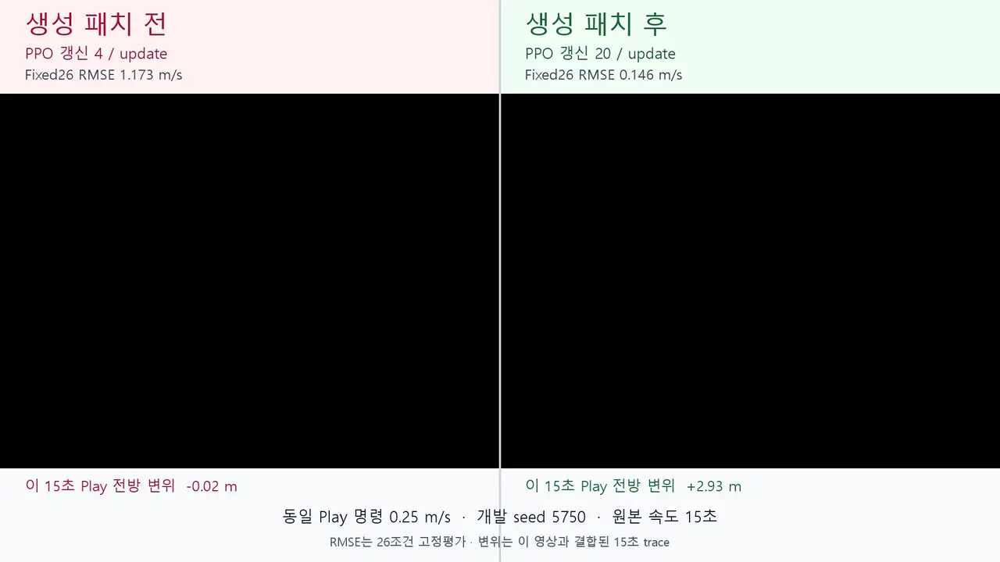

# Nemotron이 작성한 PPO 설정 패치

Nemotron 3.5가 설정·코드·실제 PPO 갱신 기록을 읽고 새 설정 어댑터를 작성하며, 실패한 CPU 검사 결과로 한 번 수정하는 개발 고리다. 모델에 정답 패치나 결함 이름은 제공하지 않았다. 호스트는 생성 코드를 제한된 AST 계약으로 검사하고, 실제 RSL-RL PPO가 해당 설정을 소비하는지 확인한다.

기존 seed 2311은 모델이 검사를 고르고 호스트가 등록 교정을 적용한 사례다. 이 측정은 수정 소스를 모델이 작성한다는 점에서 구분한다. 계단 seed 200의 정책 적응 결과도 여기에 합산하지 않는다.

## CPU 피드백 재작성 패치의 행동 회복

설정 일부를 누락하던 원 코드 `c4c710f1…`를 대상으로 만든 모델의 최종 재작성 `02fa206f…`를 새 개발 학습 seed 5753·5754에서 평가했다. CPU 최초 패치 `0ecdc01d…`는 설정에 epoch 항목이 없는 네 번째 검사에서 예외가 났고, 모델은 그 검사 피드백을 받은 뒤 다음 함수를 반환했다. 이 최종 소스의 바이트를 바꾸지 않고 사용했다.

```python
def build_algorithm_kwargs(config):
    kwargs = dict(config)
    return kwargs
```

CPU 네 설정의 update당 실제 갱신은 기대값 12·8·14·4회와 일치했다. GPU 비교는 정상·원 결함·최종 재작성 패치를 각 4,096환경에서 처음부터 300회 학습하고 같은 Fixed26으로 평가했다. GPU 단계의 새 모델 호출은 0회였다.

| 개발 seed | 정상 RMSE, m/s | 원 결함 RMSE, m/s | 재작성 패치 RMSE, m/s | 판정 |
| --- | ---: | ---: | ---: | --- |
| 5753 | 0.145369 | 1.176277 | 0.145369 | recovered, 9/9 |
| 5754 | 0.145229 | 1.177175 | 0.145229 | recovered, 9/9 |

두 seed 모두 optimizer 갱신은 1,200→6,000회, 갱신당 4→20회로 돌아왔다. 패치 정책의 낙상률은 0, 평균 생존은 20초였다. 정상 보행 참조, 원 결함 실패, 기록된 CPU 후보 입장, 패치 행동 회복, 갱신 횟수, 정상 소스 유지, reward·termination 유지, 평가 프로토콜 유지, 소유 실행·종료 영수증을 각각 확인해 두 seed 모두 9/9 조건을 충족했다. 정책 tensor 상태 해시도 각 정상 대조와 같았다.

설정 누락으로 실제 바뀐 값은 epoch 5→1, gamma 0.99→0.998, entropy 계수 0.01→0이었다. 재작성은 누락된 설정 전체의 전달을 복원하므로 epoch 하나의 인과 효과로 설명하지 않는다. `class_name`은 호스트가 복원한 알고리즘 선택 메타데이터이며, 누락된 학습 인자는 보충하지 않고 실제 PPO 생성자 기본값을 사용했다. 전달 전후와 기본값 해석은 arm별 학습 영수증에 공개했다.

이는 기록된 CPU 재작성 패치 한 개를 두 학습 seed에서 확인한 개발 결과다. 첫 수정안 `0ecdc01d…`의 GPU 성능은 측정하지 않았고, 이번 GPU 실패를 모델에 새로 입력한 진단도 아니다. 비교 영상의 왼쪽은 첫 수정안이 아니라 원 설정 누락 코드다.

[최종 결과·9조건](../evals/results/rewritten_config_patch_recovery_s5753_s5754_20261106_v1/summary.json) · [수치 CSV](../evals/results/rewritten_config_patch_recovery_s5753_s5754_20261106_v1/results.csv) · [모델의 CPU 재작성 원문](../evals/results/diagnostic_generated_patch_cpu_20261106_v1/runs/api/case-b/revision/response-01.json) · [CPU 네 설정 검사](../evals/results/diagnostic_generated_patch_cpu_20261106_v1/runs/cpu/case-b-revision/candidate.json) · [행동 사전등록](../bench/protocols/rewrite_generated_patch_recovery_s5753_s5754_20261106_v1.json)

[같은 재작성 패치의 seed 5753 전후 15초 영상](media/rewritten-config-patch-s5753-20261106-v1/comparison-15s.mp4) · [영상 출처와 프레임 결합](media/rewritten-config-patch-s5753-20261106-v1/source-manifest.json)

## 생성 패치와 CPU 검사

알려진 PPO epoch 결함 계열에서 인자 누락·상수 덮어쓰기·설정 후 재덮어쓰기 세 구현과 정상 구현 하나를 만들었다. 모두 개발용 합성 설정 어댑터이며, 처음 보는 결함군을 찾아낸 결과로 해석하지 않는다.

각 사례에 한 번씩 요청했다. 응답 네 개는 모두 첫 응답에서 출력 계약을 통과했으며, 의미 오류를 고치기 위한 재요청은 없었다.

| 검사 | 원래 결함 구현의 optimizer.step / update | 생성 패치 적용 후 | 기대값 |
| --- | ---: | ---: | ---: |
| epoch 5 · minibatch 4 | 4 | 20 | 20 |
| epoch 3 · minibatch 2 | 2 | 6 | 6 |
| epoch 2 · minibatch 3 | 3 | 6 | 6 |

세 결함 패치 모두 위 세 설정에서 실제 CPU PPO 갱신 횟수를 정상화했다. 설정마다 세 update를 관측했으며, 추가 algorithm 설정도 보존했다. 텐서로 만든 PPO 입출력 환경을 사용했으므로 이 수치는 로봇 행동 회복을 뜻하지 않는다.

정상 코드에서도 모델은 패치를 제안했다. 정상 무수정 판단은 **0/1**이다. 이 결과를 본 뒤 호스트 입장 검사를 보강해, 기존 코드의 갱신이 이미 정상일 때 수정의 승격을 차단하도록 했다. 저장된 정상 응답은 이 검사에서 차단됐다. 이 차단은 모델의 올바른 판단으로 세지 않는다.

## 결과를 본 뒤 추가한 기본값 검사

주 측정을 마친 뒤 `num_learning_epochs`를 생략한 설정을 추가로 검사했다. 설치된 RSL-RL PPO의 기본값은 1이다. 세 결함 패치 중 두 개는 `config.get("num_learning_epochs", 5)`를 넣어 생략된 설정을 5로 바꿨고, 한 개만 설치된 기본값을 보존했다. 이 검사는 사후 개발 검사이며 주 측정의 성공 분모를 바꾸지 않는다.

GPU 행동 비교에 선택한 패치는 모델 원문의 다음 소스다. 호스트가 정답 코드로 치환하지 않았다.

```python
def build_algorithm_kwargs(config):
    options = dict(config)
    return options
```

모델의 실제 응답은 [상수 덮어쓰기 사례 원문](../evals/results/ppo_generated_patch_cpu_20261106_v1/model/literal_override.response-01.json)에 보존했다. 요청한 모델은 `nvidia/nemotron-3.5-super-vl-120b-a12b`, 반환된 provider 별칭은 `private/nvidia/nemotron-3.5-super-120b-a12b`였다. 이번 입력은 텍스트이며 VL 영상 효과나 3 Super 대비 우위를 측정하지 않았다.

## GPU 행동 회복 확인

개발 seed 5750에서 정상 코드·상수 덮어쓰기 결함·모델 생성 패치를 각각 처음부터 300회 학습했다. 각 실행은 4,096개 환경을 사용했고, 같은 Fixed26(26조건·1,040환경·1,000 step, 평가 seed 2026)으로 평가했다. 입력 설정과 달라진 epoch만 교정했으며, 학습 update 예산과 task의 reward·termination 설정은 유지했다.

| 정책 | 실제 epoch × minibatch | optimizer 갱신 합계 | 추종 RMSE, m/s | 낙상률 | 평균 생존 | 판정 |
| --- | ---: | ---: | ---: | ---: | ---: | --- |
| 정상 코드 | 5 × 4 | 6,000 | 0.145786 | 0 | 20초 | healthy |
| 결함 코드 | 1 × 4 | 1,200 | 1.173056 | 0 | 20초 | unhealthy |
| 모델 생성 패치 | 5 × 4 | 6,000 | 0.145786 | 0 | 20초 | recovered |

결함 정책은 넘어지지 않고 평가 시간을 버텼지만 명령을 추종하지 못했다. 생성 패치를 적용한 정책은 정상 정책과 같은 추종 오차를 기록했다. 등록한 일곱 조건인 정상 참조 보행, 결함 실패 재현, CPU 후보 입장, 패치 정책의 고정 평가 통과, 정상 소스 유지, reward·termination 유지, 실제 갱신 인자·횟수 일치를 모두 충족했다.

이 결과는 선택된 패치 **한 개의 개발 사례**다. CPU에서 검사한 세 구현, GPU 정책 세 개, 평가 조건 26개를 독립된 회복 성공 사례로 합산하지 않는다. 정상 입력의 모델 무수정 실패 0/1과 호스트 차단 1/1도 별도 결과로 유지한다.

학습 실행 시간은 정상 492.282초, 결함 468.031초, 패치 492.812초였다. 공유 데스크톱에서 자식 실행부터 종료·정리까지 잰 관측값이며 속도 우위나 GPU 절감을 판정하는 측정으로 쓰지 않았다. 모델 요청은 CPU 단계의 네 회뿐이고 GPU 단계의 새 모델 요청은 0회다.

[행동 회복 요약](../evals/results/ppo_generated_patch_behavior_s5750_20261106_v1/summary.json) · [정상·결함·패치 평가 원문](../evals/results/ppo_generated_patch_behavior_s5750_20261106_v1/fixed/) · [학습과 갱신 기록](../evals/results/ppo_generated_patch_behavior_s5750_20261106_v1/training/) · [실행 시간·자원](../evals/results/ppo_generated_patch_behavior_s5750_20261106_v1/resources.json) · [원문 SHA 목록](../evals/results/ppo_generated_patch_behavior_s5750_20261106_v1/SHA256SUMS.json)

## 진단과 검사 피드백을 연결한 CPU 개발 측정

앞선 seed 5750 실험은 모델이 쓴 패치 한 개를 CPU에서 검사한 뒤 GPU 행동 회복까지 확인했다. 후속 CPU 개발 측정에서는 이 과정을 진단부터 다시 연결했다. Nemotron 3.5가 코드와 설정을 읽고 `P_optimizer_updates_cpu_adapter` 검사를 골랐으며, 호스트가 실제 RSL-RL CPU 경로에서 기대 갱신 수와 관측값을 대조했다. 이상이 확인된 두 사례에만 패치 작성을 허용했다.

두 결함은 모두 알려진 PPO epoch 결함 계열의 구현 변형이다. 첫 패치는 1/2만 네 설정을 통과했다. 나머지 한 건은 설정에 `num_learning_epochs`가 없을 때 예외가 났다. 호스트는 실패 원문을 모델에 한 번 돌려줬고, 수정된 패치는 설치된 PPO 기본값을 유지하면서 네 설정을 모두 통과했다. 첫 제안과 수정 제안을 합치지 않고 각각 보존했다.

| CPU 개발 사례 | 첫 패치 | 검사 피드백 뒤 | 최종 상태 |
| --- | ---: | ---: | --- |
| 잘못된 설정 키 조회 | 통과 | 사용 안 함 | admitted |
| algorithm 설정 일부 누락 | 실패 | 통과 | admitted |
| 정상 구현 A | 패치 요청 없음 | 사용 안 함 | source preserved |
| 정상 구현 B | 패치 요청 없음 | 사용 안 함 | source preserved |

정상 구현 두 건에서도 모델은 검사를 요청했다. CPU 검사에서 갱신 수가 정상으로 나오자 호스트가 패치 단계를 열지 않았고, 추가 패치 호출 없이 기존 소스를 유지했다. 따라서 이 결과는 모델의 HOLD 성공이 아니라 정상 입력 보호 게이트 2/2로 보고한다.

과거에 실패했던 패치 두 건은 생성 소스가 바이트 단위로 같아 한 대표만 수정 대상으로 삼았다. 모델은 수정 요청에 HOLD를 반환하면서 계약에 없는 근거 ID 여섯 개를 인용했다. 응답은 무효였고 결과는 HOLD 0/1이다. 새 결함 두 건의 수정 성공과 같은 분모에 넣지 않았다.

모델 전송은 9회였다. 의미 응답 8회 중 계약 유효 응답은 7회였고, 나머지 한 건은 위의 잘못된 근거 인용이다. HTTP 502 한 건은 인프라 실패로 기록한 뒤 같은 요청을 한 번 다시 보냈다. 이 CPU 측정은 새 seed의 행동 회복을 판정하지 않는다. 추가 개발 seed의 행동 평가는 아래 별도 등록에서 확인했다.

[공개 요약](../evals/results/diagnostic_generated_patch_cpu_20261106_v1/summary.json) · [모델 요청과 응답](../evals/results/diagnostic_generated_patch_cpu_20261106_v1/runs/api/) · [CPU 검사 원문](../evals/results/diagnostic_generated_patch_cpu_20261106_v1/runs/cpu/) · [SHA 목록](../evals/results/diagnostic_generated_patch_cpu_20261106_v1/SHA256SUMS.json)

## 실제 실패 관측에서 시작한 두 개발 seed 재현

추가 개발 seed 5751·5752에서는 먼저 정상 코드와 잘못된 설정 키를 읽는 결함 코드로 각각 300회 학습했다. 정상 참조의 보행과 결함 정책의 실패를 Fixed26에서 확인한 뒤, 새 Nemotron 진단·패치 요청을 등록했다. 앞선 CPU 시험의 응답을 대신 넣지 않았다.

모델은 실제 학습에서 설정 epoch 5회, 실행 epoch 1회, optimizer step 4회라는 근거 ID 네 개를 인용해 CPU 확인 검사를 골랐다. 확인 검사는 원래 GPU 설정 5×4와 별개인 CPU 시험 설정 4×3에서 기대 12회·실제 3회를 확인했다. 그 결과를 받은 모델의 새 패치는 생략된 인자 기본값을 포함한 CPU 네 설정을 첫 시도에 통과했다. 새 모델 요청 두 개는 모두 유효했고 추가 수정 요청은 없었다.

이 패치 한 개를 두 seed에서 각각 300회 학습하고 같은 Fixed26으로 평가했다. 기존 정상·결함 학습을 늘리거나 다른 seed로 교체하지 않았다.

| 개발 seed | 정상 RMSE, m/s | 결함 RMSE, m/s | 생성 패치 RMSE, m/s | 실제 step/update | 결과 |
| --- | ---: | ---: | ---: | --- | --- |
| 5751 | 0.142079 | 1.080870 | 0.142079 | 4→20 | recovered, 9/9 |
| 5752 | 0.153938 | 1.185981 | 0.153938 | 4→20 | recovered, 9/9 |

각 seed의 정상 보행 참조, 결함 실패, 모델 원문과 CPU 입장 후보의 일치, 패치 정책의 고정 평가 통과, 갱신 합계 1,200→6,000회, 정상 소스 보존, reward·termination 보존, 평가 프로토콜 보존, 소유 실행 영수증을 모두 확인했다. 패치 정책은 둘 다 낙상률 0·평균 생존 20초였다. 사후 바이트 대조에서도 각 패치 체크포인트는 같은 seed의 정상 체크포인트와 일치했다.

이는 알려진 epoch 결함 계열의 수정안 한 개를 두 학습 seed에서 재현한 개발 결과다. 모델이 서로 다른 문제 두 개를 새로 고친 성공률로 세지 않는다. 모델의 진단·패치 생성, CPU 정상화, 행동 회복, 정상 대조 보존을 각각 기록했다.

[최종 결과와 조건별 판정](../evals/results/diagnostic_generated_patch_recovery_s5751_s5752_20261106_v1/summary.json) · [새 모델 원문](../evals/results/diagnostic_generated_patch_recovery_s5751_s5752_20261106_v1/runs/api/runtime-repeat/) · [실제 관측·검사 입력](../evals/results/diagnostic_generated_patch_recovery_s5751_s5752_20261106_v1/pre-patch-summary.json) · [소스 관측 등록](../bench/protocols/diagnostic_generated_patch_sources_s5751_s5752_20261106_v1.json) · [모델 결정 등록](../bench/protocols/diagnostic_generated_patch_runtime_s5751_s5752_20261106_v1.json) · [행동 평가 등록](../bench/protocols/diagnostic_generated_patch_recovery_s5751_s5752_20261106_v1.json)

## seed 5750 생성 패치 비교 영상

기존 seed 5750의 결함 정책과 생성 패치 정책을 같은 Play 명령 `0.25m/s`로 15초씩 녹화했다. 두 원본은 2,560×1,440, 50fps, 750프레임이며, 비교 영상은 1,920×1,080, 50fps로 합성했다. 재생 속도는 바꾸지 않았다.

<a href="media/generated-ppo-patch-s5750-20261106-v1/comparison-15s.mp4"></a>

결함 정책은 15초 동안 전방으로 `-0.019m` 이동했고 평균 body-x 속도는 `0.0006m/s`였다. 패치 정책은 `2.930m` 이동했고 평균 body-x 속도는 `0.1962m/s`였다. Fixed26 추종 RMSE는 `1.173→0.146m/s`, update당 optimizer step은 `4→20`이었다. RMSE는 단일 영상 구간이 아니라 26조건 고정 평가 수치다. 두 정책 모두 낙상률이 0이므로 이 장면을 낙상 회복으로 설명하지 않는다.

[15초 1080p 영상](media/generated-ppo-patch-s5750-20261106-v1/comparison-15s.mp4) · [원본 결합과 수치](media/generated-ppo-patch-s5750-20261106-v1/source-manifest.json) · [디코드·프레임 검증](media/generated-ppo-patch-s5750-20261106-v1/verification-summary.json)

## 실행 경계

생성 소스는 `build_algorithm_kwargs(config)` 함수 하나로 제한한다. 설정 dictionary 복사·상수 조회·epoch 항목 대입·반환만 허용하며 import, 파일·네트워크·셸 접근, 반복문, 임의 함수 호출은 거부한다. 여러 설정에서 실제 갱신 횟수와 나머지 설정의 보존을 확인한 후보만 별도 GPU 등록 대상으로 삼는다.

정상·결함·선택된 패치의 GPU 비교는 같은 task·seed·환경 수·학습 update 예산과 같은 고정 평가를 사용한다. 정상 코드는 유지하고, reward·termination 설정 해시와 실제 PPO epoch·minibatch 값을 각각 확인한다. 패치 생성, 검사 정상화, 행동 회복, 정상 대조는 별개 항목으로 보고한다.

GPU v1 등록은 실행 없이 v2로 대체됐다. v2는 1회 예비 학습 통과 후 본학습 전 임대 메타데이터 접근 오류로 중단됐고, 행동 평가는 실행하지 않았다. 이 기록과 소비를 보존한 뒤 같은 seed·예산의 [v3 인프라 재시도](../bench/protocols/generated_ppo_patch_behavior_s5750_20261106_v3.json)로 위 결과를 얻었다. 자세한 기록은 [이전 시도 요약](../evals/results/ppo_generated_patch_behavior_s5750_20261106_v1/prior-infrastructure-attempt.json)에 있다.

## 근거와 재현 코드

- [CPU 공개 요약](../evals/results/ppo_generated_patch_cpu_20261106_v1/summary.json) · [주 측정 판정](../evals/results/ppo_generated_patch_cpu_20261106_v1/primary-verdicts.json)
- [주 측정 사전등록](../bench/protocols/ppo_generated_patch_cpu_20261106_v2.json) · [미실행 이전 판](../bench/protocols/ppo_generated_patch_cpu_20261106_v1.json)
- [CPU 적용 전](../evals/results/ppo_generated_patch_cpu_20261106_v1/cpu-before.json) · [적용 후](../evals/results/ppo_generated_patch_cpu_20261106_v1/cpu-after.json) · [사후 기본값 검사](../evals/results/ppo_generated_patch_cpu_20261106_v1/posthoc-default-edge.json)
- [호스트 입장 판정](../evals/results/ppo_generated_patch_cpu_20261106_v1/host-admission.json)
- [제한 소스 계약](../evals/ppo_patch_contract_v1.py) · [실제 CPU PPO 검사](../bench/inspect_ppo_patch_cpu_v1.py) · [GPU 학습 실행기](../bench/train_generated_ppo_adapter_v1.py)

이 측정의 성공 여부는 등록한 개발 사례의 결과다. 임의 저장소의 오류 수정, 미지 결함 일반화, 모델 버전 우위, GPU 비용 절감을 검증한 결과로 확대하지 않는다.
