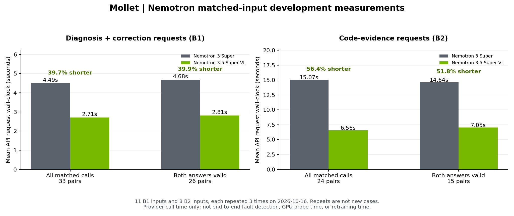
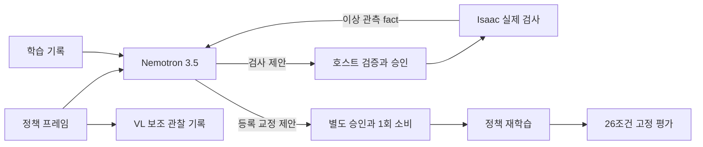

# Nemotron 3.5 적용 성과와 프로젝트 방향: 상세 근거집

기준일: 2026-10-30. Mollet의 공개 실행 기록과 NVIDIA 공식 자료를 모았다. 아래 속도·오류·영상 수치는 개발 측정이며, 같은 입력의 반복 호출을 서로 독립적인 새 사례로 세지 않는다.

## 1. 확인된 성과

| 질문 | 확인된 결과 | 근거의 범위 |
|---|---|---|
| 3.5로 응답이 빨라졌는가? | 같은 요청의 모델 ID만 바꾼 개발 비교에서 평균 API 응답시간이 B1 39.66%, B2 56.44% 짧았다. 양쪽 응답이 모두 유효한 짝에서도 각각 39.91%, 51.84% 짧았다. | 2026-10-16 hosted 요청 구간. 전체 원인 탐지·GPU 검사·재학습 시간의 감소율이 아니다. |
| 근거 제시는 나아졌는가? | D3 코드 근거 인용 오류 6/24→2/24, 계약까지 유효한 원인 1위 정답 15/24→18/24가 관측됐다. | 원인 1위만 보면 21/24→20/24였고, 전체 사전등록 해결 기준은 미충족이다. |
| VL을 실제로 사용했는가? | 정책 프레임 관찰 18/18 형식 유효, 고정 평가 분류와 17/18 대응. 별도 시연의 정상·결함·교정 정책 관찰도 3/3 대응했다. | 화면 관찰과 명령 추종 평가는 서로 다른 측정이다. 영상이 회복을 판정하지 않는다. |
| 3.5를 진단 고리에 연결했는가? | 새 동기화 영상과 학습 기록을 받은 모델이 `P_reward`를 선택했다. 실제 검사로 보상 결함을 확인한 뒤 모델이 검사 결과를 인용해 등록 교정을 제안했다. | seed 2221의 개발 실행. 인용은 telemetry 6개·frame 0개여서 영상 덕분이라는 효과는 미입증이다. |
| 교정 뒤 회복했는가? | 새 재학습 seed 3221에서 300회 학습·26조건 평가까지 완료했다. 선속도·생존·낙상은 통과했으나 yaw 기준을 넘어 `not_recovered`였다. | 고리 실행 완료와 회복 성공을 분리한다. |
| VL로 잘못된 영상 근거를 가렸는가? | 이미지에서 위치만 읽고 호스트가 상태 투영과 비교한 개발 검사에서 렌더 오류 2녹화를 격리하고 일치하는 2녹화를 유지했다. | 4녹화·3checkpoint·8프레임 호출. 첫 판의 오류 응답 4개 미탐도 보존하며 원인 진단·회복 향상으로 합산하지 않는다. |
| 기존에 못 잡던 결함도 잡는가? | PPO epoch 횟수 오류 R1과 횟수는 정상인 PPO gradient 오류를 새 계측으로 분리했다. R1은 교정·재학습 후 회복 사례도 있다. | 새 검사·등록 교정 기능의 성과다. 3.5로 모델을 바꾼 효과와 합산하지 않는다. |

핵심 설명은 **“실제 실험으로 원인을 확인하는 에이전트에, 더 짧게 관측된 API 응답시간과 VL 정책 관찰을 더했다”**이다. 일반적인 진단 정확도 향상이나 영상에 의한 원인 발견을 이미 입증했다고 설명하지 않는다.

데이터: [전체 집계](../evals/results/nemotron35_evidence_20261030_v1/summary.json) · [42개 원본 파일과 SHA](../evals/results/nemotron35_evidence_20261030_v1/sources.json) · [요청 57쌍 CSV](../evals/results/nemotron35_evidence_20261030_v1/latency_pairs.csv).

## 2. 속도: 무엇을 얼마나 측정했는가

### 2.1 비교 조건

- B1: 기존 N2 진단·교정 입력 11개 × 3회 × 두 모델. 모델마다 33회다.
- B2: 기존 D3 코드 변경 packet 8개 × 3회 × 두 모델. 모델마다 24회다.
- provider는 NVIDIA hosted API로 같고, 각 짝의 `request_without_model_sha256`가 동일하다. 57쌍 전부 다시 대조했다.
- 공통 요청값은 `temperature=0`, `max_tokens=16384`, `stream=false`, `reasoning_effort=none`이다. 두 모델 모두 공식 API에서 `none`을 지원한다.
- 요청 순서는 입력·반복마다 모델 순서를 교차했다. 새 응답을 얻기 위한 의미 오류 재시도는 없었다.
- 시간은 모델 호출 구간의 벽시계다. 검증·파일 처리, Isaac 앱 시작, 검사, 정책 학습·고정 평가는 포함하지 않는다.
- 기존에 본 자료로 설계·측정했다. 33/24회는 33/24개의 새 결함이 아니며, 일반화나 통계적 유의성을 주장하지 않는다.

비교한 요청 ID는 `nvidia/nemotron-3-super-120b-a12b`와 `nvidia/nemotron-3.5-super-vl-120b-a12b`다. 새 경로의 원시 반환 ID는 `private/nvidia/nemotron-3.5-super-120b-a12b`였다. 두 별칭의 공식 대응과 실제 서빙 가중치 revision은 확인하지 못했으므로, 비교 단위는 등록한 API 요청 경로다.

### 2.2 평균 응답시간 재집계

| 과제·선별 | 비교 짝 수 | 기존 3 Super 평균(s) | 3.5 평균(s) | 평균 대기시간 감소 | 3.5가 더 짧은 짝 |
|---|---:|---:|---:|---:|---:|
| B1 진단·교정 요청 / 전체 짝 | 33 | 4.487947 | 2.708074 | 39.66% | 27/33 |
| B1 진단·교정 요청 / 양쪽 모두 유효 | 26 | 4.680635 | 2.812700 | 39.91% | 21/26 |
| B2 코드 근거·원인 순위 / 전체 짝 | 24 | 15.065440 | 6.562133 | 56.44% | 21/24 |
| B2 코드 근거·원인 순위 / 양쪽 모두 유효 | 15 | 14.642023 | 7.051026 | 51.84% | 13/15 |

감소율은 `(기존 평균 - 새 평균) / 기존 평균 × 100`으로 계산했다. “양쪽 모두 유효”는 결과를 본 뒤 고른 보조 분석이다. 전체 요청 결과와 함께 제시하며 사전등록된 별도 성능 평가로 취급하지 않는다.

원본: [요청별 메타데이터](../evals/results/nemotron_endpoint_bottlenecks_20261016_v3/requests.json), [기존 집계](../evals/results/nemotron_endpoint_bottlenecks_20261016_v3/summary.json). 재집계: [JSON](../evals/results/nemotron35_evidence_20261030_v1/latency_analysis.json), [CSV](../evals/results/nemotron35_evidence_20261030_v1/latency_pairs.csv), [SVG](../evals/results/nemotron35_evidence_20261030_v1/latency_comparison.svg).

### 2.3 중앙값·누적시간·토큰

| 과제 | 항목 | 기존 | 3.5 |
|---|---|---:|---:|
| B1 | 중앙값(s) | 3.857046 | 1.434760 |
| B1 | 33회 요청 시간 합(s) | 148.102236 | 89.366447 |
| B1 | 입력 토큰 합 | 70,902 | 70,902 |
| B1 | 출력 토큰 합 | 5,828 | 8,147 |
| B2 | 중앙값(s) | 13.064695 | 3.533380 |
| B2 | 24회 요청 시간 합(s) | 361.570551 | 157.491185 |
| B2 | 입력 토큰 합 | 98,736 | 98,736 |
| B2 | 출력 토큰 합 | 17,925 | 18,274 |

3.5의 출력 토큰이 더 적어서 짧아진 비교는 아니다. 다만 요청 전체 시간에는 서버 대기·입력 처리·생성이 함께 들어가므로, 이 값에서 생성 tokens/s나 특정 추론 커널의 기여를 역산하지 않는다. TTFT, 실제 서버 GPU·정밀도·부하와 MTP 활성화 상태는 기록에 없다.

B3 NAT 경로는 기존 16회·새 모델 11회로 후속 도구 경로와 입력 누적량이 달라졌다. 각각 요청 시간 합 57.690초·17.041초를 기록했지만, 이 합계의 감소율을 같은 작업의 모델 속도 개선으로 쓰지 않는다.

## 3. 품질: 좋아진 항목과 그대로 남은 항목

| 측정 | 기존 | 3.5 | 해석 |
|---|---:|---:|---|
| B1 계약 유효 | 29/33 | 28/33 | 새 모델의 전체 형식 유효율이 더 높지는 않았다. |
| B1 계약 무효 | 4/33 | 5/33 | 사전등록 무효 상한·퇴행 방지 조건 미충족. |
| B1 진단 평균 pass³ | 0.667 | 0.667 | 반복 세 번을 모두 통과하는 일관성 개선 없음. |
| B1 교정 평균 pass³ | 0.600 | 0.800 | 개선 관찰이지만 전체 해결 판정을 대신하지 않는다. |
| B2 근거 인용 오류 | 6/24 | 2/24 | 오류 감소가 관측됐다. 0건 조건에는 못 미쳤다. |
| B2 계약 유효 | 18/24 | 19/24 | 소폭 증가 관찰. |
| B2 파싱된 원인 1위 정답 | 21/24 | 20/24 | 원인 순위 자체의 전반적 개선은 확인하지 못했다. |
| B2 계약까지 유효한 원인 1위 정답 | 15/24 | 18/24 | 수용 가능한 원인 답의 수는 늘었다. |
| B3 NAT 검증 오류 이벤트 | 3 | 2 | 서로 다른 실패 사례 수가 아니라 이벤트 수다. |
| B3 최종 유효 제출 | 1/2 | 1/2 | 도구 인자 병목은 미해결. |

원인 순위를 맞히는 능력, 근거를 정확히 인용하는 능력, 출력 계약을 지키는 능력은 나눠 평가한다. “B1~B3 미해결”은 모든 개별 지표가 나아지지 않았다는 뜻이 아니라, **측정 전에 고정한 전체 해결 조건을 통과하지 못했다**는 뜻이다.

[품질 CSV](../evals/results/nemotron35_evidence_20261030_v1/model_quality.csv) · [원문 판정](../evals/results/nemotron_endpoint_bottlenecks_20261016_v3/decisions.json) · [사전등록](../bench/protocols/nemotron_endpoint_compare_v3.json).

## 4. VL: 정책 화면과 그래프를 읽는 기능

### 4.1 정책 프레임 관찰 18건

각 정책에서 프레임 여섯 장을 제공했다. 정상 정책의 `walking=yes`, 실패 정책의 `walking=no`를 고정 평가 분류와의 대응으로 정의했다.

| 고정 평가 분류 | walking=yes | walking=no | unclear | 대응 |
|---|---:|---:|---:|---:|
| 정상 | 7 | 0 | 0 | 7/7 |
| 실패 | 1 | 10 | 0 | 10/11 |
| 합계 | 8 | 10 | 0 | 17/18 |

응답 형식은 18/18 유효였다. 사전등록 하한은 전체 16/18, 정상 6/7, 실패 10/11이었으며 이 보조 관찰 기준을 충족했다. 학습 수치의 healthy/unhealthy와 프레임의 걷기 관찰이 대응한 결과다. 사람이 독립 라벨링한 영상 행동 정답에 대한 94.4% 정확도라고 표현하지 않는다.

| 정책 ID | 고정 평가군 | 걷기 | 제자리 | 넘어짐 | 대응 |
|---|---|---|---|---|---|
| motor_before | failure | yes | no | no | 불일치 |
| motor_corrected | normal | yes | no | no | 대응 |
| reward_dev_before | failure | no | yes | no | 대응 |
| reward_dev_corrected | failure | no | no | yes | 대응 |
| reward_dev_sham | failure | no | no | yes | 대응 |
| reward_2026_before | failure | no | no | no | 대응 |
| reward_2026_resume | failure | no | no | yes | 대응 |
| reward_2026_std | failure | no | no | yes | 대응 |
| reward_2026_none | normal | yes | no | no | 대응 |
| reward_2026_clean_resume | normal | yes | no | no | 대응 |
| reward_2028_before | failure | no | yes | no | 대응 |
| reward_2028_resume | failure | no | yes | no | 대응 |
| reward_2028_std | failure | no | no | yes | 대응 |
| reward_2028_none | normal | yes | no | no | 대응 |
| reward_2028_clean_resume | normal | yes | no | no | 대응 |
| demo_2030_fault | failure | no | yes | no | 대응 |
| demo_2030_none | normal | yes | no | no | 대응 |
| demo_2030_restart | normal | yes | no | no | 대응 |

불일치 `motor_before`는 고정 평가상 실패였지만 모델이 `walking=yes`로 관찰했다. 움직임이 보여도 명령을 제대로 추종한다는 뜻은 아니므로, 이 경우에 영상만으로 회복을 판단하지 않는다.

B4 전체 21회는 영상 관찰 18회·평가 밖 가능성 확인 1회·그래프 질문 2회다. 입력 36,519토큰, 출력 475토큰, 요청 시간 합 15.523초였다. 21개 독립 정책을 평가한 수치로 바꾸지 않는다.

[18건 JSON](../evals/results/nemotron35_evidence_20261030_v1/vl_observations_18.json) · [18건 CSV](../evals/results/nemotron35_evidence_20261030_v1/vl_observations_18.csv).

### 4.2 진단·교정 시연에 붙인 VL 관찰

| seed 2080 시연의 정책 | 고정 평가 | 걷기 | 제자리 | 넘어짐 |
|---|---|---|---|---|
| 정상 2080 | healthy | yes | no | no |
| F1 결함 2080 | unhealthy | no | yes | no |
| 교정 후 재학습 3080 | healthy | yes | no | no |

세 관찰 모두 유효하고 고정 평가 분류와 3/3 대응했다. `used_for_decision=false`다. 이 시연의 진단·교정 결정 모델은 기존 3 Super였고, 3.5 VL은 보조 관찰 세 번을 담당했다. 총 호출은 결정 2회·관찰 3회로 5/16이며 이들을 전부 3.5 진단 성공으로 세지 않는다.

[시연 결과](../evals/results/vl_aux_demo_public_s2080_20261016/summary.json) · [관찰 CSV](../evals/results/nemotron35_evidence_20261030_v1/vl_aux_observations_3.csv) · [실제 입력 프레임 예시](../evals/results/vl_aux_demo_public_s2080_20261016/frames/clip2/frame_03.jpg).

### 4.3 가능성 확인

- 합성 이미지 한 장의 도형 세 개에서 색·모양·위치 묶음 3/3을 맞혔다. 정책 성능 측정과 별개인 이미지 입력 확인이다.
- 평가 밖 영상 한 건의 프레임에서 걷기 관찰을 반환했다. 18건 평가와 합산하지 않는다.
- 학습 곡선 그림의 질문 두 개에 유효한 응답을 받았다. 정상 곡선의 추종 보상·속도 오차 방향과 결함 곡선의 개선 부재를 읽었다. 독립 그래프 판독 성능 평가는 아니다.

[가능성 확인 데이터](../evals/results/nemotron35_evidence_20261030_v1/vl_capability_checks.json).

## 5. 영상과 실제 원인 진단은 어디까지 연결됐는가

### 5.1 이전 24입력 개발 비교

텍스트 전용 8회, 영상 전용 8회, 텍스트+영상 8회가 모두 유효했고 모두 `P_reward`를 골랐다. 영상 조건에서 다른 검사나 HOLD로 바뀐 쌍은 0/8이었다. 이후 렌더 감사가 프레임을 넣은 16호출의 원본 녹화에 영향을 확인했다. 과거 결과는 보존하며 영상 선택 이득으로 쓰지 않는다.

B4 관찰에 쓰인 18개 영상과 감사 대상 6개 영상 사이에는 동일 SHA가 없었다. 이것은 B4까지 같은 바이트의 문제가 확인됐다는 뜻이 아니며, B4 녹화 전체가 별도 렌더 검증을 통과했다는 뜻도 아니다.

### 5.2 새 동기화 녹화와 첫 3.5 선택

seed 2221 정상·F1 정책을 각각 625프레임, 50fps, 12.5초로 새로 녹화했다. render-sync 625회와 same-Play 상태 결합을 확인했다. 명령 수평 속도는 1.0m/s였고, 두 관찰 창에서 정상 속도는 0.99358·0.95270m/s, F1 속도는 0.01388·0.00304m/s였다. 이 비교는 새 녹화의 상태 관찰이며 교정 후 회복 영상은 아니다.

모델 입력에는 정책별 세 장씩 총 여섯 프레임이 들어갔다. `P_reward` 선택은 유효했지만 인용은 telemetry 6개, frame 0개, same-Play 0개였다. 이미지가 입력에 포함됐다는 사실과 이미지가 선택을 바꿨다는 효과는 구분한다.

### 5.3 실제 검사→후속 교정 제안→재학습→평가

1. `P_reward`를 256환경×200스텝으로 실행했다. 보상 공식 상대 오차는 정상 `1.6901418784520673e-08`, F1 `0.30962626162916423`이었다. 동결 상한 0.05로 normal/abnormal을 가른다. 이 숫자는 몸체 속도 오차가 아니다.
2. API 11은 전송 연결 오류로 끝났다. 의미 판단 전 인프라 실패이며 모델 오진으로 세지 않았다.
3. 보존한 같은 입력의 API 12에서 모델은 `observation:0:P_reward:outcome`을 인용해 `restore_body_frame_reward`를 제안했다. 응답은 유효했고 모델 호출 구간은 2.917초였다.
4. 별도 호스트 승인 후 fresh seed 3221을 4096환경×300 update로 재학습했다. learn 구간 454.079초, 학습 worker 전체 471.046초였다.
5. 정상·교정 정책을 동일한 26조건으로 평가했다. 평가 구간은 각각 34.7초·34.4초였다.

| 고정 평가 | 정상 2221 | 교정 재학습 3221 | 등록 판정 |
|---|---:|---:|---|
| 선속도 RMSE(m/s) | 0.148632 | 0.144703 | 비율 0.973570 ≤ 1.1513: 통과 |
| yaw RMSE(rad/s) | 0.177753 | 0.287933 | 비율 1.619850 > 1.1719: 실패 |
| 평균 생존(s) | 20.000000 | 19.989365 | 비율 0.999468 ≥ 0.9: 통과 |
| 낙상률(비율) | 0 | 0.000962 | ≤ 0.05: 통과 |

최종 `not_recovered`를 보존했다. 보상 코드 복원은 readback으로 확인됐지만 늘어난 yaw 제곱오차의 94.04%가 `[0,0,-1]`, `[0,0,1]` 두 제자리 회전 조건에 집중됐다. 이는 결과를 본 뒤 계산한 기술 통계다. 조건을 제외하거나 회복 기준을 바꾸지 않았다.

후속 [같은 seed 정상 대조](SAME-SEED-RECOVERY-CONTROL.md)는 seed 3221의 NONE 정책을 별도로 300회 학습했다. 새 정상 정책은 교정 정책과 checkpoint 바이트 및 26조건 평가 수치가 같았다. 정상 대조도 기존 seed 2221 참조와의 비교에서 회전 기준을 넘었으므로 등록 분기는 `seed_or_command_coverage_consistent`였다. 이번 조건에서 교정 경로는 같은 seed 정상 학습을 재현했다. seed 또는 명령 커버리지 중 어느 요소가 회전 약점을 만드는지는 확정하지 않았고, 원래 미회복을 새 성공으로 바꾸지 않는다.

[검사와 모델 원문 결합](AGENTIC-LOCAL-F1-FOLLOWUP.md) · [회복 평가 결과](AGENTIC-LOCAL-F1-RECOVERY.md) · [조건별 52행](../evals/results/agentic_local_f1_recovery_s3221_20261030_v1/evaluations/).

### 5.4 영상 자체의 신뢰성 검사

[블라인드 위치 관찰과 호스트 검사](VISUAL-INTEGRITY-OBSERVER.md)를 실제 호출했다. 모델에 예상 상태 좌표를 보여 주지 않고 이미지 한 장에서 로봇 상자만 읽게 했다. 호스트가 상자 중심을 same-Play 상태 투영과 비교한 결과, 렌더 오류 프레임 4/4는 격리하고 수정 프레임 4/4는 일치로 판정했다. 원본 4녹화의 3초·6초만 검사했으며 고유 checkpoint는 3개다. 모델이 원인·회복을 판정한 결과는 아니다.

첫 판에서는 좌표와 여섯 이미지를 함께 주었고 오류 응답 4개도 모두 일치로 답했다. 그 실패 뒤에 좌표 비공개·단일 이미지·detail 속성 생략을 묶어 보완했으므로 개별 수정의 인과 효과나 모델 교체 효과를 주장하지 않는다. 실제 관찰 영수증을 소비하는 CPU 게이트에서 오류 녹화의 후속 소비는 두 건 모두 차단됐다. 새 진단·교정·학습은 실행하지 않았다. [V1 실패 원문](../evals/results/visual_integrity_dev_20261030_v1/summary.json) · [V2 결과](../evals/results/visual_localization_dev_20261030_v2/summary.json) · [그림](media/visual_integrity_dev_20261030_v2/same_checkpoint_render_review.png).

### 5.4 최근 같은 수치 비교의 호출 불가

2026-10-30의 별도 F2 두 계보·F1 두 계보 A/B 비교에서는 기존 3 Super가 4/4 HTTP 404였고, 3.5는 4/4 유효했으나 네 번 모두 `P_episode`를 골랐다. 첫 선택이 등록 확인 검사인 횟수는 0/4였다. 기존 모델의 과거 응답을 새 비교에 대신 넣지 않았다. 모델 목록에 ID가 있어도 실제 생성 성공을 뜻하지 않는다.

따라서 이 최근 비교의 `inconclusive`와 10/16의 완료된 B1/B2 속도 측정은 서로 다른 결과다. 최근 호출 불가가 과거 속도 관측을 지우지는 않으며, 과거 결과가 최신 API 경로의 정상 가동을 보장하지도 않는다.

[최근 A/B 결과](NEMOTRON35-SAME-INPUT-RESULT.md).

## 6. 3 Super 대비 무엇이 바뀌었는가: 공식 기술 조사

| 항목 | Nemotron 3 Super | Nemotron 3.5 Super VL | 프로젝트에서의 의미 |
|---|---|---|---|
| 모델 카드의 명목 총 파라미터 | 120B | 120B | 작은 모델로 교체해서 빨라졌다는 설명은 맞지 않는다. |
| 토큰당 활성 파라미터 | 12B | 12B | sparse MoE 계열을 계승했다. |
| 텍스트 백본 | Mamba-2·LatentMoE·Attention·MTP | 같은 hybrid sparse 계열 | Mamba·MoE·MTP 자체를 3.5에서 처음 도입한 것으로 설명하지 않는다. |
| MoE 전문가 | [공식 3 Super 보고서](https://research.nvidia.com/labs/nemotron/files/NVIDIA-Nemotron-3-Super-Technical-Report.pdf)의 512 experts/layer, top-k 22 | 공식 카드의 512 routed experts/layer; 새 top-k 미확인 | 전문가 수 증가가 속도·정확도 개선의 원인이라는 근거는 없다. |
| 입력 종류 | 텍스트 | 텍스트·이미지·영상 프레임 | 새로 연결한 정책 화면 관찰을 가능하게 하는 기능 차이다. |
| 비전 구성 | 해당 모델 카드에 비전 입력 없음 | C-RADIO 비전 인코더 + vision-language connector | 이미지 표현을 언어 백본에 연결한다. connector 내부 압축률은 미확인이다. |
| 문맥 길이 | 가중치 최대 1M | 가중치 최대 1M | 새로 길어진 수치가 아니다. 실제 hosted 배포 한도와 가중치 상한도 구분한다. |
| 생성 효율 | 이미 MTP·NVFP4 계열 지원 | recursive MTP 강화, 양자화·캐시·커널·drafter 레시피 | 공식 가속 메커니즘 후보다. 우리 API에서의 활성 구성은 알 수 없다. |
| 학습 | 텍스트 중심 사전·후학습 | Ultra Base 증류, agentic·VL·장문맥 관련 후학습 확대 | 기능·품질 개선의 후보 배경이며 프로젝트 정확도 향상의 인과 증거는 아니다. |

모델 카드의 120B/12B와 달리 [기존 Build](https://build.nvidia.com/nvidia/nemotron-3-super-120b-a12b/build)와 [새 Build](https://build.nvidia.com/nvidia/nemotron-3.5-super-vl-120b-a12b) 카탈로그는 두 endpoint 모두 Parameters=124B로 표기했다. 표기 차이의 계산 범위는 확인하지 못했다. 총 파라미터가 줄었다고 주장하거나 그 차이를 비전 인코더 크기로 역산하지 않는다.

공식 자료: [3 Super 모델 카드](https://huggingface.co/nvidia/NVIDIA-Nemotron-3-Super-120B-A12B-BF16), [3.5 BF16 모델 카드](https://huggingface.co/nvidia/NVIDIA-Nemotron-3.5-Super-VL-120B-A12B-BF16), [3.5 모델 설명](https://docs.api.nvidia.com/nim/reference/nvidia-nemotron-3_5-super-vl-120b-a12b). 문서별 게시·개정일과 지원 주장은 [공식 출처 원장](NEMOTRON35-ARCHITECTURE-SOURCES.md), 구조화된 값은 [architecture_comparison.json](../evals/results/nemotron35_evidence_20261030_v1/architecture_comparison.json)에 있다.

### 6.1 속도와 연결될 수 있는 공식 메커니즘

1. **MTP 강화:** 3.5의 MTP boosting 전후 acceptance length는 greedy 4.287→4.718, probabilistic 3.787→4.612로 보고됐다. 이것은 **3.5 안에서 boosting 전후를 비교한 공식 값**이며 3 Super와 3.5의 프로젝트 비교값이 아니다. 여러 초안 토큰을 한 번에 수용하면 생성 효율이 좋아질 수 있다. [3.5 기술보고서](https://research.nvidia.com/labs/nemotron/files/NVIDIA-Nemotron-3.5-Super-and-Lightning-Technical-Report.pdf)
2. **서빙 최적화:** NVIDIA는 hybrid-state/prefix cache, Mamba checkpointing, GPU kernel 선택, speculative decoding을 함께 조율했다고 설명한다. 특정 조건의 NVFP4 대 BF16 처리량 2.43배도 보고했지만, 이는 **같은 3.5 모델의 배포 정밀도 비교**다. [공식 연구 개요](https://research.nvidia.com/labs/nemotron/Nemotron-3.5-Super-and-Lightning/)
3. **학습·증류:** 3.5는 3 Super Base 계열에서 시작해 더 큰 모델의 증류와 agentic/VL 후학습을 거쳤다. 정답·도구·영상 이해 능력 변화의 후보 설명이다. 이 프로젝트의 B1~B3에서는 모든 품질 지표가 일관되게 나아지지는 않았다.

확인된 것은 **같은 요청값을 보낸 새 endpoint가 그 개발 측정에서 더 짧은 평균 요청 시간을 보였다**는 사실이다. 어느 GPU·정밀도·MTP·캐시·대기열이 그 차이를 만들었는지는 분리하지 못했다. 두 요청 모두 `reasoning_effort=none`이었으므로 새 모델에만 추론을 끈 효과로 설명할 수는 없다. [두 API와 실제 요청값 대조](../evals/results/nemotron35_evidence_20261030_v1/api_reference_evidence.json)

### 6.2 구조가 속도 원인인지 더 확인하려면

동일 하드웨어·정밀도에서 두 가중치를 번갈아 실행하고, MTP on/off·캐시 warm/cold를 통제하며 TTFT·생성 토큰 수·처리율을 분리해 측정해야 한다. 이 실험은 아직 수행하지 않았다. 현재 발표에서는 hosted 요청의 실측 차이까지 설명하고, 특정 내부 최적화로 인한 가속이라고 단정하지 않는다.

## 7. “못 잡던 것을 잡음”은 어느 기능의 성과인가

| 사례 | 이전에 놓친 지점 | 새 기능의 실제 결과 | 3.5 모델 교체 효과인가? |
|---|---|---|---|
| R1 PPO epoch 무시 | 기존 동결 검사 여섯 종류로는 모두 normal | 23회 개발 배치에서 R1 1건 abnormal, 나머지 22건 normal. 새 update-count 검사에서 기대 20회 대신 4회를 발견. seed 2071은 교정 후 회복. | 아니다. 새 호스트 계측·등록 검사·교정 효과이며 당시 결정 모델은 3 Super였다. |
| `inverse_ratio` 계산 오류 | optimizer 횟수는 정상 | 새 gradient 불변식은 첫 update 0에서 abnormal, 60 batch 확인. 정상 3seed·복원은 normal. | 아니다. 모델 API 0인 계측 결과다. |
| 계측 비용 | v4 ON/OFF 비 1.564·1.522·1.632로 상한 1.5 초과 | v5 0.955·1.155·1.182로 모두 상한 통과, 정상 state/loss 일치 | 모델과 별개인 계측 구현 개선이다. |
| 복합 보상+PPO 결함 | 첫 교정만으로 미회복 | 2120·2121 모두 두 번째 진단·교정 후 회복. 검사 순서는 서로 달랐고 모델이 골랐다. | 당시 3 Super의 개발 시연이다. 3.5 결과로 바꾸지 않는다. |
| U1 보상 교정 범위 부족 | 등록된 일부 항만 복원해 남은 항 누락 | 함수군 네 항을 복원한 뒤 2051·2062 회복 | 모델 API 0, 호스트 범위 검사·등록 교정 효과다. |

R1의 기대/관측 optimizer step은 NONE `20·20·20`, R1 `4·4·4`였다. 처음 쓴 seed 2060 및 별도 정상 2061에서도 횟수 판별을 확인했다. seed가 새로웠다는 사실만으로 설계자가 결함 유형을 본 개발 결합이 없어지는 것은 아니다.

[기능별 18행 CSV](../evals/results/nemotron35_evidence_20261030_v1/core_features.csv) · [R1](OPTIMIZER-OBSERVABILITY.md) · [PPO 계산 검사](PPO-GRADIENT-CHECK.md) · [두 번째 고리](RESIDUAL-DIAGNOSIS-RESULT.md) · [U1](U1-SCOPE-EXTENSION.md).

## 8. 프로젝트 방향과 다음 개발 순서

프로젝트의 핵심 목적은 유지한다. **로봇이 학습을 마쳤어도 과제에 실패할 때, 모델이 다음 검사를 고르고 실제 실험으로 원인을 좁혀 등록 교정과 고정 평가까지 연결하는 것**이다. Nemotron 3.5는 이 안에서 빠르게 관측된 요청 응답과 멀티모달 관찰을 담당한다. 새 모델의 일반 우월성을 증명하는 별도 벤치마크 프로젝트로 바꾸지 않는다.

| 순서 | 다음 일 | 완료 기준 |
|---|---|---|
| 1 | 현재 성과·수치·한계를 발표 입력에 함께 고정 | 속도, 품질, VL 보조 관찰, 실제 고리와 회복 결과가 각각 원문으로 연결되고 서로 합산되지 않음. 이 근거집이 담당한다. |
| 2 | 정상 참조와 교정 경로를 구분 | 같은 seed NONE 300회 대조 완료: 정상·교정 checkpoint와 26조건 지표가 일치했다. 기존 `not_recovered`와 기준은 유지하며, 후속 판정에 참조 seed 차이를 함께 표시한다. |
| 3 | 영상 근거의 정합성 검사 | 별도 메인 실행에서 개발 녹화 4건의 위치 관찰·호스트 판정·후속 소비 차단까지 확인했다. 외부 P7 반환과의 통합 및 새 계보 확인은 남아 있다. |
| 4 | 한 범위가 검증되면 새 계보 확인 | 개발 사례에서 기능을 고정한 뒤 새 계보에서 재현. 보여 주기 위한 검사·모델 종류 추가를 우선하지 않음. |

Brev GPU는 시뮬레이션·정책 학습·녹화에 쓰였고, 위 언어 모델 응답은 hosted NIM에서 받았다. Brev의 GPU 종류를 바꾼 것을 모델 응답시간 차이의 원인으로 설명하지 않는다.

## 9. 발표에 사용할 문구와 수치 단위

### 사용 가능한 문구

> “같은 요청을 두 모델에 보낸 개발 측정에서, Nemotron 3.5의 평균 API 응답 대기시간은 두 작업군에서 약 40%, 56% 짧았습니다.”

> “Nemotron 3.5 Super VL에 정책 영상과 학습 기록을 함께 제공하고, 모델이 제안한 실제 검사로 보상 결함을 확인했습니다. VL을 활용한 정책 동작 관찰도 진단 고리에 연결했습니다.”

> “정책 프레임 관찰 18건 중 17건이 고정 평가 분류와 대응했고, 회복 판정은 별도 행동 평가로 유지했습니다.”

> “기존 검사로 놓친 PPO 갱신 오류는 새 계측으로 확인했습니다. 모델은 검사 후보를 제안하고, 호스트가 실행과 판정의 증거를 남깁니다.”

### 바꾸어 말하면 안 되는 수치

| 원래 수치 | 잘못된 확대 |
|---|---|
| 모델 API 평균 대기시간 약40%·56% 감소 | 원인 탐지·학습 전체가40%·56% 빨라짐 |
| 17/18 고정 평가 분류와 대응 | 영상만으로 원인 진단 정확도94.4% |
| VL 입력에 프레임6장 포함 | 영상 덕분에 더 좋은 검사를 선택 |
| 인용 오류6→2, 수용 가능한 원인1위15→18 | 전반적 진단 정확도가 향상됐음 |
| R1 신규 계측·수리 성공 | 3.5 모델을 바꾸어 R1을 새로 찾아냄 |
| seed3221 학습·평가 완료 | 3.5 고리의 새 회복 성공 |
| NVIDIA의 특정 MTP·NVFP4 공식 처리량 | 우리 API가 그 설정으로 운영됐고 같은 배수의 효과를 냄 |

## 10. 데이터 묶음과 재계산 범위

- `latency_pairs.csv`: 같은 입력 57쌍, 원문 요청 SHA·반복·유효성·시간·토큰.
- `latency_analysis.json`: 전체 및 양쪽 유효 쌍의 평균·중앙값·합계·짧아진 쌍 수·계산 범위.
- `model_quality.csv`: B1/B2 모델별 계약·원인·근거 오류 집계.
- `vl_observations_18.*`: B4 정책 18행, 입력 클립·평가·checkpoint SHA와 모델 관찰.
- `vl_aux_observations_3.*`: seed2080 세 관찰, `used_for_decision=false`.
- `vl_capability_checks.json`: 합성 이미지·평가 밖 영상·그래프의 소량 확인.
- `vl_selection_and_render.json`: 24입력 비교·새프레임 선택·렌더 감사와 SHA 중복 점검.
- `core_features.csv`: 새 검사·교정 기능 성과 18행, 선택 주체·결과·측정 경계.
- `architecture_comparison.json`, `api_reference_evidence.json`: 공식 기술 차이와 실제 고정 요청값.
- `sources.json`, `SHA256SUMS`: 근거 원본 42파일과 산출물 SHA. 원문 raw SHA와 Git용 LF 정규화 SHA를 함께 보존하며 원본 파일은 바꾸지 않았다.

이 근거집의 재집계·공식자료 조사에는 새 inference·GPU 실행을 추가하지 않았다. 10/30의 8회 A/B 호출과 300회 교정 학습은 그 전에 별도 등록·실행한 기록으로 포함했다. API 키·요청 헤더·비공개 원시 프롬프트·사용자 경로는 묶음에 넣지 않는다. 수치의 출처가 없는 내용은 성과에 합산하지 않는다.
