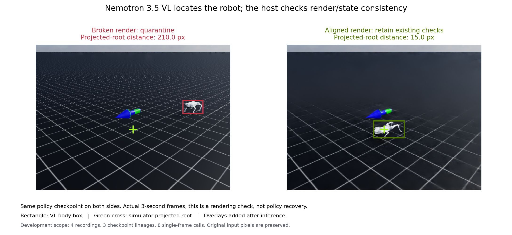

# 영상과 상태가 어긋날 때 영상 근거를 보류한다

Nemotron 3.5 Super VL이 이미지에서 로봇 위치를 읽고, 호스트가 시뮬레이션의 투영 위치와 비교하는 검사를 추가했다. 이미 본 개발 녹화 4건의 3초·6초 프레임을 검사해 렌더 오류 2건은 격리하고 위치가 일치하는 2건은 유지했다. 위치 관찰 응답 8개가 모두 유효했고 사전등록 기준을 충족했다. 고유 checkpoint는 3개이며, 8개의 독립 고장 사례를 평가한 결과는 아니다.



두 패널은 같은 정책 checkpoint의 실제 3초 프레임이다. 사각형은 모델이 읽은 로봇 상자, 초록 십자는 시뮬레이션 root 투영이다. 표시선은 추론이 끝난 뒤 설명용으로 넣었으며 모델은 원본 픽셀을 받았다. 정책 회복은 별도 고정 평가로 판단한다.

## 모델 관찰과 호스트 판정을 분리한다

1. **입력 검증:** 원래 NPZ·RGB pixel SHA·native manifest·trace·PTS를 결합한다. 원문 픽셀을 바꾸지 않은 PNG를 사용한다. 기존 capture/model 승인 플래그는 바꾸지 않는다.
2. **블라인드 관찰:** 모델은 이미지 한 장과 frame ID·시각·해상도만 받는다. 예상 위치, 상태 수치, 렌더 감사 정답, checkpoint와 사례 이름은 보내지 않는다.
3. **위치 추출:** 모델은 로봇의 표시 여부와 정규화 좌표의 bounding box만 반환한다. 원인·일치 여부·회복을 판정하지 않는다.
4. **호스트 검사:** 상자 중심과 예상 root 투영의 차이가 30픽셀 이하면 일치, 60픽셀을 넘으면 불일치다. 예상 위치가 화면 안인데 로봇이 없으면 불일치다. 중간 구간과 불확정 관찰은 HOLD다.
5. **후속 소비:** 두 시각 모두 일치해야 검사한 두 프레임을 기존 승인 경로의 후속 소비자에 전달한다. 둘 다 불일치하면 격리하고, 판단이 갈리면 HOLD한다. 이 게이트는 실행 승인 권한을 만들지 않는다.

## 첫 실패도 보존했다

첫 판은 여섯 프레임과 예상 위치를 함께 주고 모델에 일치 여부를 물었다. 응답 8개는 모두 형식상 유효했지만 렌더 오류 응답 4개도 전부 `consistent`였다. 모델은 예상 위치를 실제 영상 관찰처럼 설명했다. 이 결과를 기능 성공으로 처리하지 않았다.

그 실패를 본 뒤 두 번째 판을 설계했다. 수치 좌표를 숨기고, 요청당 한 프레임만 보내며, 문서에서 의미를 확인하지 못한 `detail` 속성도 생략했다. 세 변경을 묶어서 확인했으므로 어느 변경 하나가 개선을 만들었다고 단정하지 않는다. 두 판 모두 같은 3.5 모델을 사용했다.

| 판 | 호출 단위 | 유효 응답 | 오류 자료 격리 | 수정 자료 일치 | 사전등록 결과 |
| --- | --- | ---: | ---: | ---: | --- |
| V1 모델의 일치 판단 | 4녹화 × 2회, 요청당 6프레임 | 8/8 | 0/4 응답 | 4/4 응답 | `partial_or_not_confirmed` |
| V2 위치 추출 + 호스트 검사 | 4녹화 × 3초·6초, 요청당 1프레임 | 8/8 | 4/4 프레임 | 4/4 프레임 | `feature_confirmed_development_only` |

두 판의 호출 단위가 달라 통제된 모델 A/B 비교나 속도 비교로 쓰지 않는다. V1의 API 요청 시간 합은 11.682초·26,183토큰, V2는 6.298초·4,315토큰이었다. 입력 크기가 다른 측정값이며 모델 가속률을 계산하지 않는다. 총 요청은 16회, 자동 재시도·추가 학습·GPU·Brev 실행은 0회다.

## V2의 실제 위치 관찰

| 녹화 | 3초 | 6초 | 두 시각의 호스트 게이트 |
| --- | --- | --- | --- |
| 기존 2221 NONE 렌더 오류 | 투영에서 210.010px 이탈 | 로봇이 보이지 않음 | 격리 |
| 수정된 2033 NONE 렌더 | 투영에서 15.411px | 14.210px | 일치 |
| 기존 2220 NONE 렌더 오류 | 투영에서 205.573px 이탈 | 297.206px 이탈 | 격리 |
| 수정된 2221 NONE 렌더 | 투영에서 15.048px | 10.251px | 일치 |

모든 자료는 기존 파일·시각·카메라 수치 결합 검사를 통과했다. 그 검사에는 픽셀의 로봇 위치가 없으므로 렌더 불일치를 가르지 못했다. V2는 VL에서 얻은 위치를 새 관측값으로 사용한다. 단순 mask/기하 검사는 정답 라벨과 방법을 공유하므로, 이 결과를 규칙 대비 LLM 정확도 우위로 해석하지 않는다.

호출 뒤 입력을 다시 대조했다. 같은 시각의 네 요청은 이미지 외의 문자 메시지와 요청 파라미터가 같았고, 모델에 전달한 메시지에서 달라진 내용은 이미지였다. 모델은 화면에 따라 서로 다른 위치 또는 로봇 부재를 반환했고 호스트 판정은 기존 기하 라벨과 일치했다. 이 확인은 해당 위치 관찰에서 픽셀 정보를 활용했다는 근거이며, 영상의 원인 진단·검사 선택 이득을 뜻하지 않는다. [문자 입력 대조 SHA](media/visual_integrity_dev_20261030_v2/matched_text_check.json).

실제 VL 영수증으로 후속 소비 게이트도 CPU에서 실행했다. 오류 녹화 두 건의 소비자 호출은 각각 0회, 일치 녹화는 각각 1회였고 검사한 3초·6초 두 프레임만 전달됐다. 이 확인에서 추가 API는 없었고 새 원인 진단·교정·재학습도 수행하지 않았다.

## 재현과 적용 범위

- [V1 사전등록](../bench/protocols/visual_integrity_experiment_dev_20261030_v1.json)·[실패 결과와 원문](../evals/results/visual_integrity_dev_20261030_v1/summary.json)
- [V2 사전등록](../bench/protocols/visual_localization_experiment_dev_20261030_v2.json)·[결과](../evals/results/visual_localization_dev_20261030_v2/summary.json)·[관측 좌표·토큰·시간](../evals/results/visual_localization_dev_20261030_v2/calls.csv)·[소비 차단 기록](../evals/results/visual_localization_dev_20261030_v2/consumption_gate.json)
- [실행기](../evals/visual_localization_experiment_v2.py)·[원문 결합 manifest](../evals/results/visual_localization_dev_20261030_v2/manifest.json)·[그림 출처](media/visual_integrity_dev_20261030_v2/source_manifest.json)

저장된 실제 응답의 판정을 다시 계산할 때는 다음 명령을 쓴다. 모델 호출·키·GPU 없이 실행하며 출력은 새 파일이어야 한다.

```powershell
cd $HOME/rl-triage-agent
python evals/visual_localization_experiment_v2.py score --run evals/results/visual_localization_dev_20261030_v2 --protocol bench/protocols/visual_localization_experiment_dev_20261030_v2.json --labels evals/results/visual_localization_dev_20261030_v2/labels.json --out $HOME/rl-triage-work/visual-localization-replay.json
```

이번 두 프로토콜의 요청은 모두 소진됐다. 새 실제 호출은 원래 기록을 보존하는 별도 사전등록·예산으로 준비한다.

원문과 라벨은 모델 호출 전에 SHA로 고정했다. 설계자가 기존 렌더 오류를 본 뒤 만든 개발 검사이며, 새 seed·다른 로봇·다른 카메라의 일반성을 확인한 것은 아니다. 이 검사는 지정한 두 프레임의 위치 일치를 확인한다. 전체 영상·관절 자세의 정합성을 보장하거나, 영상 때문에 진단 검사를 더 잘 골랐다는 근거로 쓰지 않는다. 기존 미회복 결과와 원래 승인 플래그도 유지한다.

NVIDIA는 PNG/JPEG base64 `image_url` 입력을 문서화하고 있다. `detail` 속성의 실제 효과, 여섯 이미지의 처리 보장, bbox 전용 API는 확인되지 않아 V2는 단일 이미지의 텍스트 위치 응답을 검증했다. [NIM 이미지 입력](https://docs.nvidia.com/nim/large-language-models/latest/advanced-use-cases/multimodal-input.html), [해당 모델 API](https://docs.api.nvidia.com/nim/reference/nvidia-nemotron-3_5-super-vl-120b-a12b).
